# fly-chess

**A real fruit fly's nervous system, all 163,803 neurons of it, learning chess in TensorFlow.**

A fruit fly has never seen a chessboard. So I took the MaleCNS connectome (every neuron and every synapse of one male fly, traced from electron microscope images), showed the board to its eyes, read a move out of the neurons that normally tell its legs to walk, and tried to teach it chess. Then I gave it a board that looks like chess.com, so you can play against it like against any other bot and watch its brain light up while it thinks :D

**What I'm actually testing.** Could a real fly brain, in principle, learn chess? Not a chess engine shaped like a fly, the measured wiring of one. So there's no search anywhere in here: no alpha-beta pruning, no Monte Carlo tree search, no thinking moves ahead the way Stockfish or AlphaZero do. The fly sees the board once, the signal runs through its real neurons for 12 steps, and whatever its descending neurons say is the move. (The dopamine fly sniffs the position after each of its own moves instead, one look per move and nothing deeper, and the backprop flies can do the same with the [Imagination switch](#making-it-stronger-without-cheating), off by default and rated on its own.) I could bolt a search on top and the Elo would jump, but then the search would be the one playing chess and the fly would only be its evaluation function, a plain neural network with no biological meaning. So anything that makes it stronger has to be something a fly brain could plausibly do.

Still in early beta, open source, fork it if you want to add to the project.

<p>


</p>

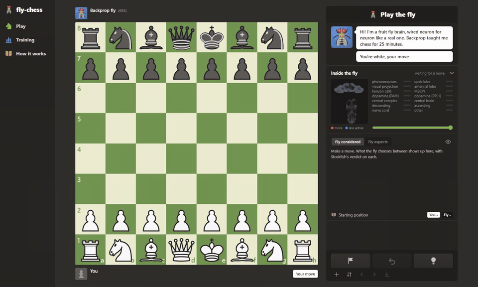
*One move in real time. I play e4, the fly's brain on the right replays the board travelling from the eye to the legs, then it answers Nf6 and says how sure it was. Under the brain: the moves it was choosing between, graded by Stockfish, then what it expects me to play.*

## Contents

1. [What's in here](#whats-in-here)
2. [Quick start](#quick-start)
3. [How the fly is doing](#how-the-fly-is-doing)
4. [The fly was brain dead](#the-fly-was-brain-dead)
5. [How a fly brain works](#how-a-fly-brain-works)
6. [From a board to a move](#from-a-board-to-a-move)
7. [The model in TensorFlow](#the-model-in-tensorflow)
8. [The data](#the-data)
9. [Cheats: learning fast on a laptop](#cheats-learning-fast-on-a-laptop)
10. [How backprop works here](#how-backprop-works-here)
11. [The biological version](#the-biological-version)
12. [The maths](#the-maths)
13. [Measuring strength](#measuring-strength)
14. [Playing against it](#playing-against-it)
15. [Fly brains are everywhere right now](#fly-brains-are-everywhere-right-now)
16. [Making it stronger without cheating](#making-it-stronger-without-cheating)
17. [Two days on a laptop: what worked and what didn't](#two-days-on-a-laptop-what-worked-and-what-didnt)
18. [Limitations](#limitations)
19. [Project layout](#project-layout)
20. [Credits and references](#credits-and-references)

## What's in here

- **The real wiring.** 163,803 neurons and 6,234,868 connections from the [MaleCNS v1.0](https://male-cns.janelia.org/) connectome. Who connects to whom, and whether a connection excites or inhibits, is never changed.
- **Two ways to learn.** A backprop version (how a computer would teach a brain) and a dopamine version (how a real fly learns, only the mushroom body changes, no backprop at all).
- **A board like chess.com's.** Pick a fly like you'd pick a bot, each with its own measured Elo, then play: drag or click, premoves, takebacks, hints, the opening's name, and a fly that tells you how sure it was about its move. Next to the board, its 139,593 neurons with a known cell body light up step by step while it thinks.
- **Predictions with an honest second opinion.** Before every move you see the fly's probability for each candidate (like `e5 62%, d5 11%, ...`), and Stockfish grades each one with Lichess's accuracy formula. There is a blur button if you'd rather not know.
- **Everything I did to make it learn on a laptop**, with the measured speed-up of each trick, plus the things that didn't work. And a Kaggle notebook, so longer runs can happen with the laptop closed.
- **Controls that could say no, and did.** The same recipe on a brain with shuffled wiring and on brains with regions cut out. The shuffled brain won, and [that's in here too](#measuring-strength).

## Quick start

Built and tested on my Lenovo LOQ: Ryzen 7 7840HS, 16 GB RAM, RTX 4060 Laptop (8 GB). TensorFlow dropped GPU support on native Windows after 2.10, so the Python side runs in WSL2 (Linux inside Windows). The browser runs on Windows as normal.

**1. Set up WSL2 and the Python environment.** In PowerShell as admin, once: `wsl --install -d Ubuntu-22.04` (I used Fedora, both work). Install the normal NVIDIA driver on Windows, WSL picks the GPU up from it. Then inside WSL:

```bash
git clone https://github.com/S1MS4/fly-chess.git && cd fly-chess
bash scripts/setup_wsl.sh               # Python 3.12, TensorFlow with CUDA, Stockfish
source ~/.venvs/flychess/bin/activate   # every new terminal
```

The script ends by printing `GPU: [PhysicalDevice(...)]`. If it prints `[]`, the driver or WSL is the problem, not this code. (It also fixes a TensorFlow 2.21 quirk: it can't find `libcusolver` from pip on its own and silently falls back to the CPU.)

**2. Get the data.** About 1 GB in total.

```bash
python scripts/download_connectome.py       # 570 MB, the three MaleCNS tables
python -m flychess.connectome --build       # about 15 s
python scripts/download_chessbench.py       # 3 million positions with Stockfish's opinion of every move
python -m flychess.train_dl --prepare       # about 90 s on 16 cores
```

**3. Train.** You say how long, it fits the schedule into that and stops.

```bash
python -m flychess.train_dl --minutes 25    # the backprop fly
python -m flychess.train_bio --minutes 15   # the dopamine fly
```

Both save as they go and continue where they left off if you run them again. Want hours of training without your laptop? See [training in the cloud](#8-train-in-the-cloud-with-the-laptop-closed).

For a whole day on the laptop there's a script that does it the fast way ([cheat 9](#9-a-day-on-a-laptop-measured-first)) and keeps an eye on the temperature:

```bash
python scripts/make_curriculum.py                                  # won positions for the curriculum, about 40 minutes
setsid nohup bash scripts/train_day.sh > runs/train_day.log 2>&1 &  # then about 24 hours, safe to stop and rerun
setsid nohup bash scripts/train_more.sh >> runs/train_more.log 2>&1 & # after it, more for as long as you let it
```

and on Windows, `pythonw tools\windows_helper.py --hours 1000`, so the laptop doesn't fall asleep (keep the lid open). `train_more.sh` never stops by itself: every 8 hours it fits the fly on everything so far and plays its Elo games, and when the disk is down to 25 GB the oldest positions make room for new ones. `touch runs/dl-day/stop` ends it after the file it's on, a last fit and its Elo. The cache grows by about 0.8 GB per file and stops at `MAX_CACHE_GB` (100). If C: is short on space, put it on another drive and leave a junction behind; mine lives on my second SSD: `mklink /J runs\dl-day\cache D:\fly-chess\dl-day-cache` (in cmd, after moving the folder there; WSL follows it). To see how it's going, `python tools/watch.py` in any terminal draws the run as bars and refreshes every 5 seconds: what it's doing now and how far along, the best fly so far, the temperatures, how hard the heat guard is throttling it, and the disk. It only reads the logs, so you can close it whenever.

**4. Play.**

```bash
uvicorn app.server:app --port 8000
```

Open http://localhost:8000 in the Windows browser, pick a fly and press Play. No build step, no npm.

The Elo next to each fly comes from `python -m flychess.rating --games 20` (about an hour, [how it works](#an-elo-after-all)). Run it again after training and the interface shows the new ratings.

## How the fly is doing

After 25 minutes of training on my laptop, the backprop fly picks Stockfish's favourite move in **19.9%** of positions it has never seen, and a move within 1 win% of it in **29.2%**. A "fly" that never looks at the board gets 11.7% and 19.5%, so about 8 points of that come from reading the board through the real eye and the real brain. Picking a random legal move would get 3%.

| | Top-1 | Good moves | Held-out loss |
|---|---|---|---|
| never looks at the board (the blind baseline) | 11.7% | 19.5% | |
| calibrated brain + readout probe, about 3 minutes | 18.0% | 26.6% | 3.040 |
| after 25 minutes of training | 19.9% | 29.2% | 2.963 |
| **the day-long fly, after two days and 26.2 million positions** | **23.5%** | **34.3%** | **2.840** |

*All on the same 4,096 held-out ChessBench positions. Good move: within 1 win% of Stockfish's best, because chess is full of ties. How the day-long fly got there, and where it stalled, is in [two days on a laptop](#two-days-on-a-laptop-what-worked-and-what-didnt).*

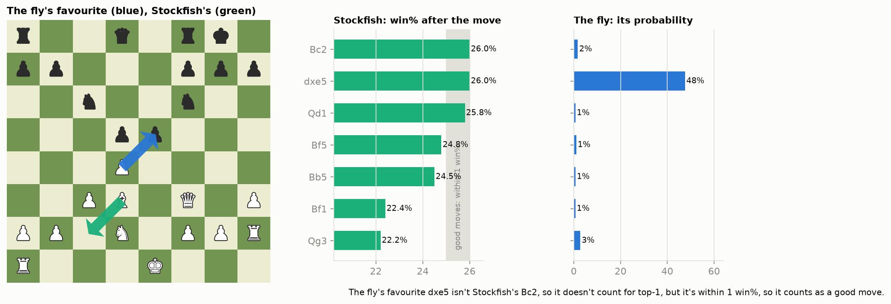
*Held-out position 22, from the side to move. The fly puts 48% on dxe5, and Stockfish gives dxe5 and Bc2 exactly the same chance, 26.0%, but lists Bc2 first. So for top-1 the fly got it wrong, as a good move it got it right. That's why I log both.*

**Which piece it moves.** A move has thousands of possible "classes", every from and to square, too many for a confusion matrix. So here the classes are the piece that moves. On the 4,096 held-out positions, the day-long fly moves the same piece as Stockfish's best move 49.2% of the time, and makes exactly Stockfish's move 23.6% of the time ([tools/confusion.py](tools/confusion.py), the numbers in [results/confusion.json](results/confusion.json)).

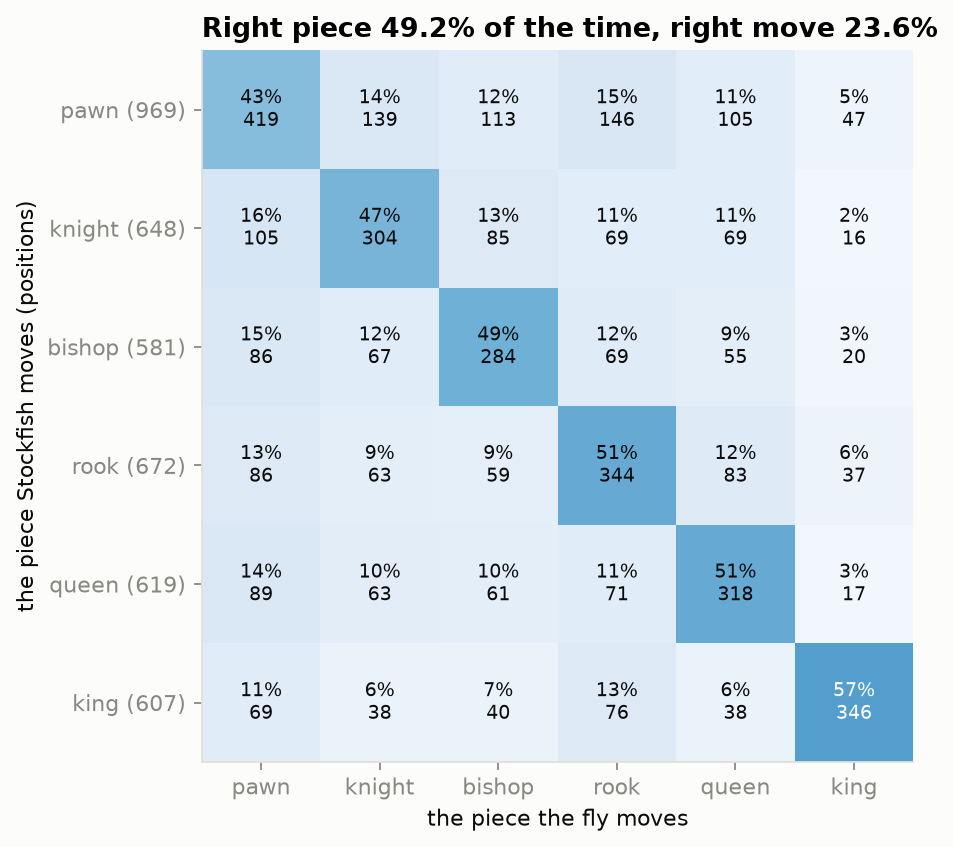
*A row is the piece Stockfish's best move moves, a column the piece the fly's favourite move moves; each row adds up to 100%, and the small number is positions. Pawn moves are the hardest to match (43%), king moves the easiest (57%), and the mistakes spread over all the other pieces fairly evenly: there's no one confusion it keeps making.*

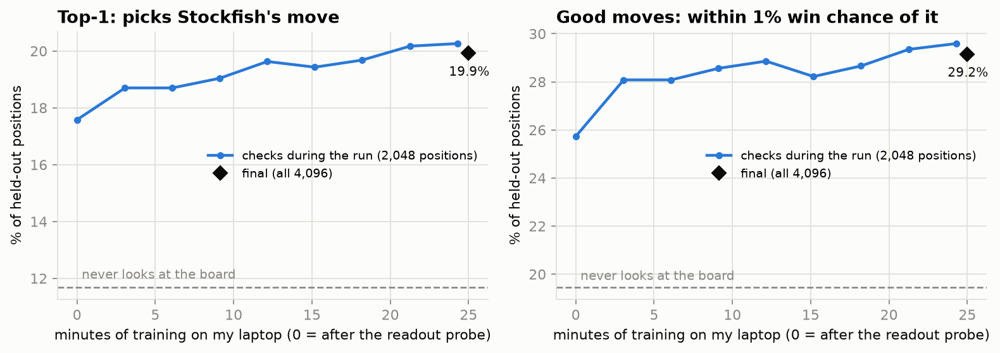

The trend matters more than the last number. Top-1 went from 17.6% to 20.3% on the checks during the run, and the loss on held-out positions fell at every single check. It only flattened at the end because the learning rate is scheduled to reach zero exactly when the time is up. 526,976 positions in 25 minutes, 351 a second, so a longer run should keep going, which is what the [Kaggle notebook](#8-train-in-the-cloud-with-the-laptop-closed) is for.

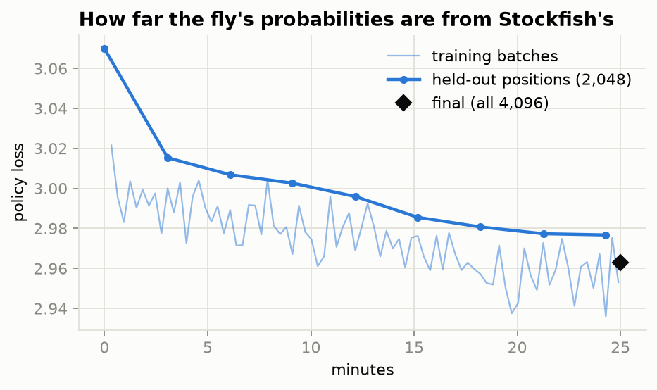

**What it plays.** After 1.e4 it answers **Nf6 20%**, d5 10%, Nc6 9%, d6 8%, e6 8% and e5 6%. Every one of those is a real opening (Alekhine, Scandinavian, Nimzowitsch, Pirc, French and the open game) and Stockfish calls all six good. It rates its own position at -0.12 (on a scale from -1 lost to +1 won, and black really is slightly worse after 1.e4), and after Nf6 it expects me to play Nf3, d4, e5 or Nc3. That's the GIF at the top.

**What it looks at.** A lesion experiment, but on the board instead of the brain: take one piece away at a time, run the fly on all 29 boards at once, and see how much its chosen move loses.

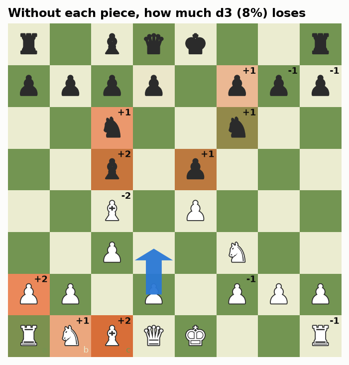

*The Italian Game after 4...Nf6, the fly to move. Its favourite is d3 at 8%, and each number is how many points of that 8% go missing without that piece (minus: d3 gets more likely).*

No single piece moves it by more than 2 points, and the ones that move it most are its own bishop on c1, its pawn on a2 and Black's bishop on c5, not the pieces anywhere near d3. A player would look at the centre. The fly reads the whole board more like a texture.

**In games** it's another story. It never loses to a random or a greedy mover, but it can't finish them off either (2 wins and 38 draws in 40 games), and it lost all 20 against Stockfish's weakest setting. On a rating ladder anchored at that setting it comes out at **683 Elo**, about as strong as a mover that always takes the biggest piece it can. Why, and what I fixed on the way, is in [measuring strength](#measuring-strength). The day-long fly is at **792**, and at **995** with its [imagination](#making-it-stronger-without-cheating) switched on, when it wins two games in three.

**The dopamine fly** learned too, a little: from 48.7% to 53.3% at telling Stockfish's move from a random one. Getting there meant finding out it had been measuring rounding noise and learning backwards, which is in [the biological version](#the-biological-version).

## The fly was brain dead

This is the part I'm most proud of finding, because it means every run of the first version was learning from nothing.

The first version had all the right ideas: real wiring, signed synapses, the board fed into the photoreceptors. I trained it for a few minutes and the loss barely moved, so I measured what each brain region was doing. Every neuron behind the photoreceptors had a firing rate of **exactly zero**, for every board, at all 12 steps.

The reason is two facts that are each fine alone:

1. Photoreceptors release histamine, which inhibits the next cell. That part is real biology.
2. In this model every neuron starts at rate 0, and a rate can't go below 0 (`relu`).

In a real eye the cells behind the photoreceptors fire all the time, and light makes them fire *less*, so the signal is the drop. In a model where they start at 0, inhibiting them does nothing. The board stopped at the first synapse. With zero activity there is also zero gradient, so backprop could only train the readout's biases. The best it could ever learn was "these squares are popular", which on the old data scored 16% top-1 against a 16.6% baseline that never looks at the board at all.

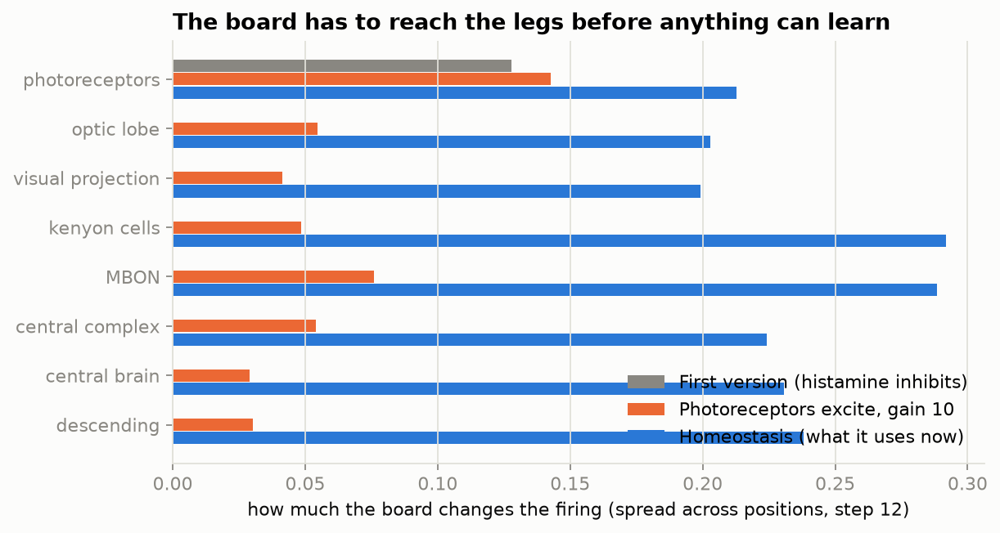
*How much the board changes each region's firing at step 12, measured on 48 real positions. Grey: the first version, nothing past the eye. Orange: photoreceptors flipped to excitatory and the volume turned up, the signal fades on the way. Blue: homeostasis, what the model uses now.*

Fixing it took three attempts:

| Attempt | What I changed | Signal at the descending neurons | Result |
|---|---|---|---|
| 0 | nothing (the first version) | 0.000 | dead, no gradient |
| 1 | photoreceptors excite (the same choice my other fly project makes) | 0.00002 | alive at the eye, gone after 3 hops |
| 2 | every neuron's inputs add up to 10 instead of 1 | 0.030 | reaches the legs, weakly |
| 3 | homeostasis: each neuron's input centred and scaled | **0.238** | 8x more, nothing saturated |

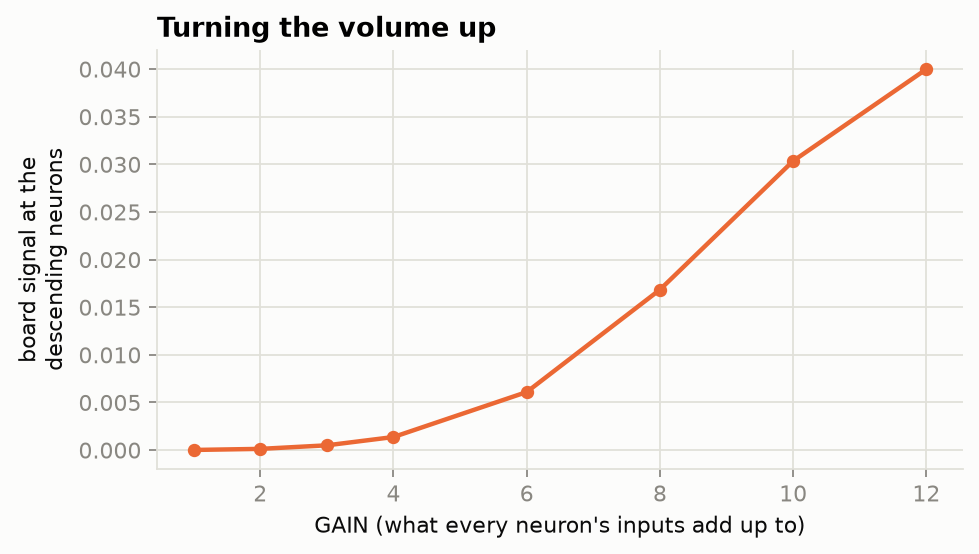

The reason attempt 1 fades: every neuron's input weights add up to 1, but only a few of its inputs are active at once, so each synapse passes on a fraction of the signal. After three or four hops there's nothing left. Turning the volume up (attempt 2) helps until the mushroom body starts to saturate.

Attempt 3 is borrowed from how real neurons stay in their working range (homeostatic plasticity) and from LSUV, the "all you need is a good init" paper. You show the brain 256 real positions once, and for every neuron and every step it remembers the average input and how much it varies. From then on each neuron sees its input centred and scaled. I tried the per-neuron version without centring first, and it blew up: weights up to 32,768, biases down to -9,861, 79% of the Kenyon cells stuck at full speed. The worst setup I tried.

<p>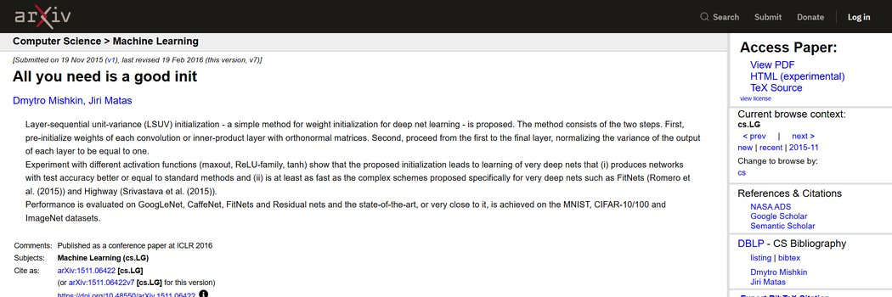 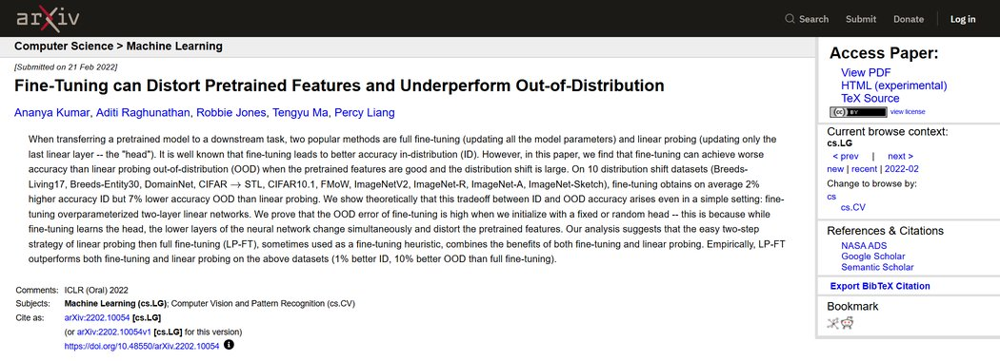</p>

*Two papers this project leans on: LSUV for waking the network up, LP-FT for fitting the readout first and then fine-tuning gently.*

Two more things broke on the way, both shown in the [cheats](#cheats-learning-fast-on-a-laptop):

- Neurons whose input never moved during calibration got scaled up 1000x, so the tiniest weight change threw them from silent to saturated. A floor of 0.02 on the spread fixed it.
- Fine-tuning the whole brain after the readout was fitted made the fly *worse*, top-1 dropping from 17.8% to 12.5%, at every learning rate I tried. Training only the readout kept improving it, so that's the default now (cheat 5).

## How a fly brain works

A neuron adds up signals from other neurons and, if the total is high enough, sends its own signal on. Some connections excite (push the next neuron towards firing), some inhibit. Everything a brain does comes from which neurons connect to which, how strongly and with what sign.

A fruit fly has about 140,000 neurons in its brain plus about 25,000 in the nerve cord that runs down its body. A human has about 86 billion. Small, but a fly still sees, smells, walks, flies, remembers and decides, all with one wiring diagram you can now download.

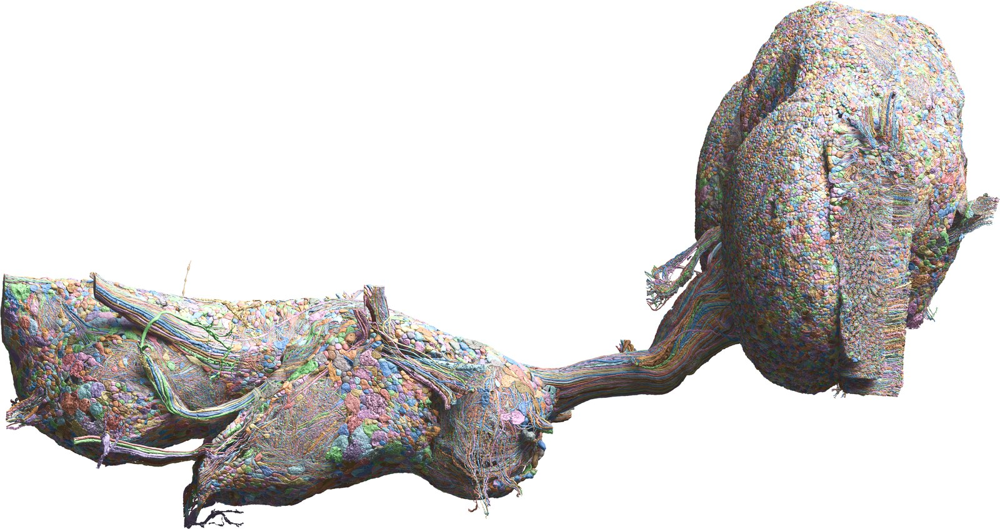
*Every neuron of the male fly's central nervous system, brain on the right, nerve cord on the left. Render: FlyEM, HHMI Janelia, [male-cns.janelia.org](https://male-cns.janelia.org/), CC BY 4.0.*

The parts that matter here, in the order a signal goes through them:

- **Photoreceptors** in the compound eye, about 800 facets per eye, each with eight light-sensing cells. R1 to R6 mostly see brightness and motion, R7 and R8 colour.
- **The optic lobes**, more than half of all the fly's neurons. They turn raw light into edges, motion and "something is there".
- **Visual projection neurons** carry that picture into the central brain.
- **The mushroom body**, the learning centre. About 2,000 Kenyon cells per side each answer to a small mix of inputs, so every smell (or here, every position) lights up its own sparse pattern. They feed a few dozen output neurons (MBONs) that vote "approach" or "avoid", and **dopamine neurons** decide which of those connections change. That is where memory lives.
- **The central complex** handles navigation and where to go.
- **Descending neurons**, about 1,300, the brain's output cable down to the legs and wings: walk, turn, stop, take off.

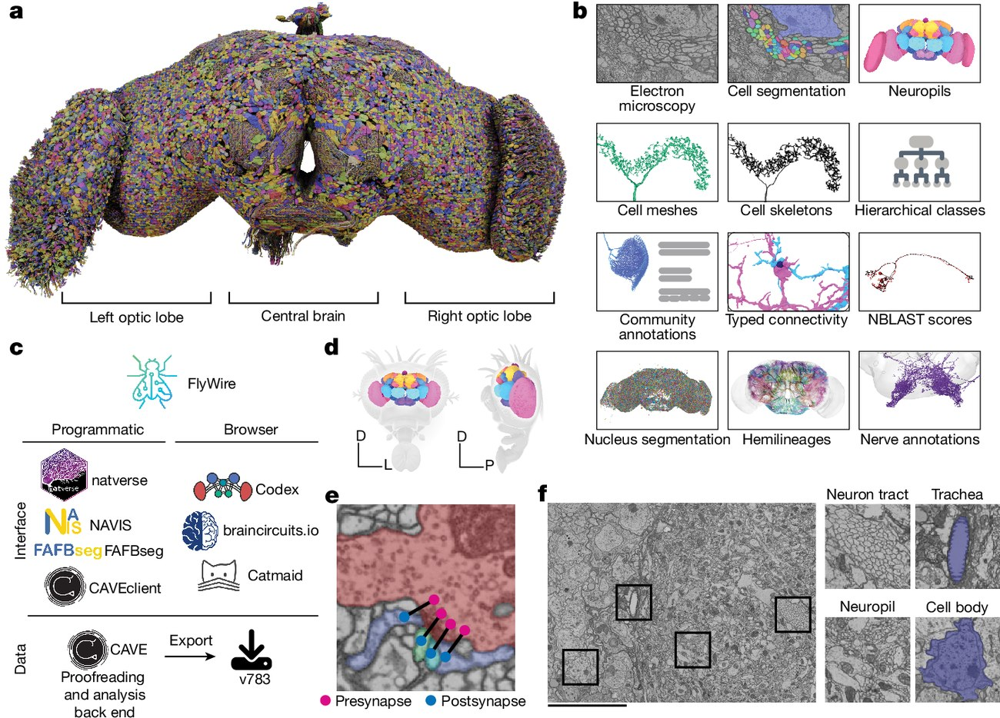
*The female fly brain connectome from FlyWire, the project before MaleCNS, with how it was built: electron microscopy, cell segmentation, synapses. Dorkenwald et al., Nature 2024, CC BY 4.0.*

## The connectome

A connectome is the full wiring diagram. MaleCNS is public and needs no account. `scripts/download_connectome.py` gets three tables (the "traced-only" weights, half the size of the full file and all this project uses):

| Table | Rows | What's in it |
|---|---|---|
| body annotations | 211,577 | type, class, superclass, side and cell body position of every traced body |
| neurotransmitters | 1.8 M | which chemical each body most likely releases |
| connection weights | 25,563,197 | `body_pre`, `body_post`, `weight` = number of synapses between them |

`python -m flychess.connectome --build` squeezes them into `data/connectome/brain.npz`. Three choices happen there:

**Which neurons.** Traced neurons with a known superclass, no glia. Only connections with at least 5 synapses: a single synapse is often a tracing error, and the cut takes 25.6 M connections down to 6.2 M (10 synapses would leave 2.7 M).

**Which sign.** A synapse doesn't say whether it excites. The transmitter does:

| Transmitter | Here | Why |
|---|---|---|
| acetylcholine | excite | the fly's main excitatory transmitter |
| GABA | inhibit | the main inhibitory one |
| glutamate | inhibit | in flies it mostly works through an inhibitory channel (GluCl) |
| histamine | inhibit, except photoreceptors | see [the fly was brain dead](#the-fly-was-brain-dead) |
| dopamine, serotonin, octopamine | excite, weakly | slow modulators, a simplification |

If the consensus call is "unclear" it falls back to the cell type's prediction, then the neuron's own.

**Which region.** Every neuron gets one of 14 regions, which drives the brain viewer and makes lesion experiments one flag.

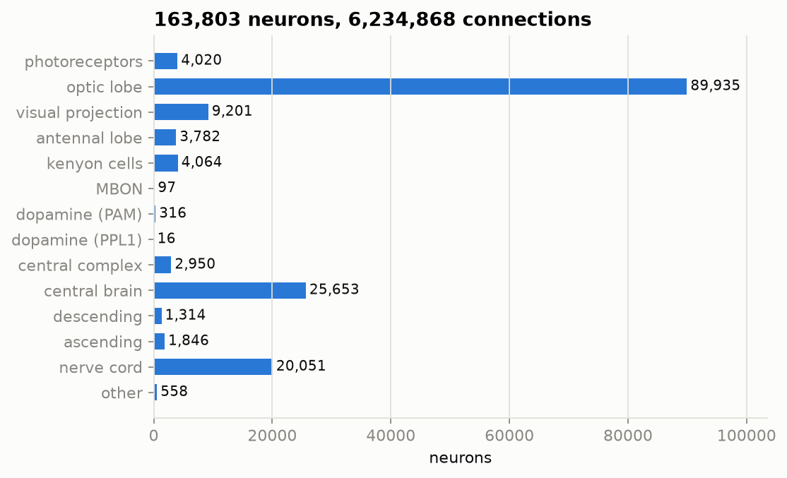

One thing I didn't expect: the brain is a small world. The shortest path from a photoreceptor to a descending neuron is 2 synapses, and almost every neuron is 2 to 4 hops from both ends. I'd hoped to cut the parts that can't reach the legs within 12 steps and save compute, but 98% of the connections are on such a path, so there was nothing to cut.

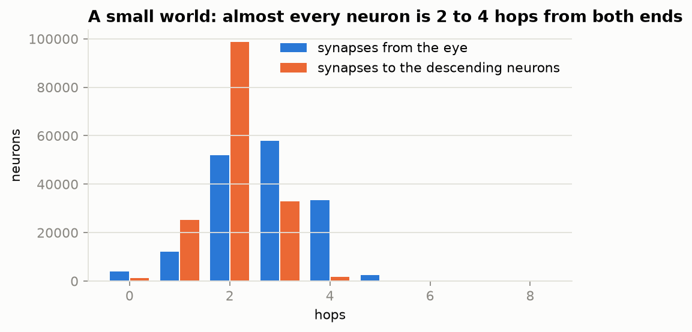

## From a board to a move

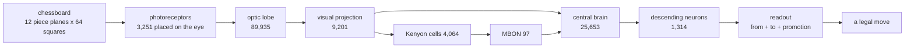

### The board goes in through the eye

The tables don't say which eye column a photoreceptor sits in, but the lamina and medulla cells right behind them do. So each photoreceptor takes the column of the cell it talks to most, which places 3,251 of the 4,020 on the eye (both eyes, laid on top of each other). Then the eye gets cut into an 8 by 8 grid, one patch per square.

My first cut took the two column coordinates separately: the file from where a cell ranks along hex1, the rank from where it ranks along hex2, so every file and every rank got an eighth of the cells. I wrote here that this gives every square about the same number of columns. It doesn't. The eye is round, but in those two coordinates it's a tilted oval, so two corners of the grid came out empty: **12 squares had no photoreceptor at all**, g1 among them, where the fly's king goes when it castles, and 33 couldn't tell one piece type from another. Every fly in the tables below learned chess with two corners of the board blacked out :c

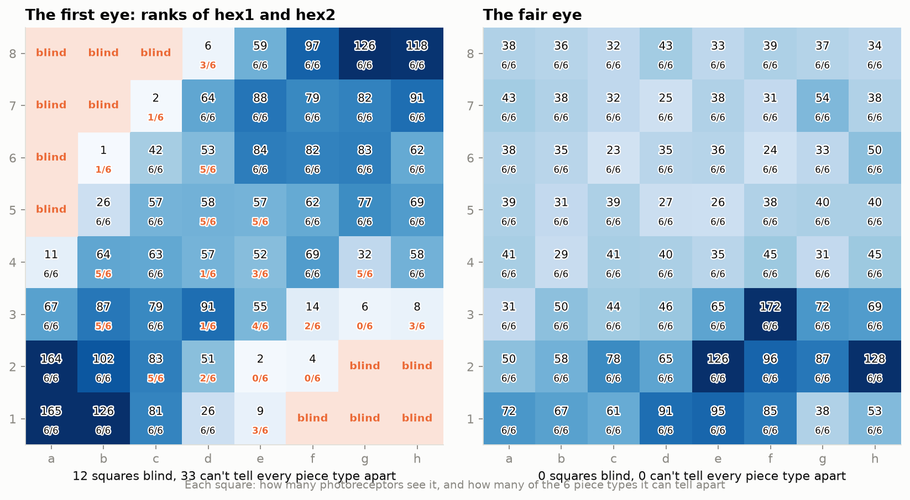

The fair eye cuts the oval itself: 8 bands of equal size along `hex1 + hex2`, then every band into 8 squares along `hex1 - hex2`. The cells of one column stay together, and the cut counts the piece-type cells (R1 to R6), because one part of the eye has none of them placed. Now every square has between 23 and 172 photoreceptors and at least 8 that tell piece types apart, so all six types are covered everywhere.

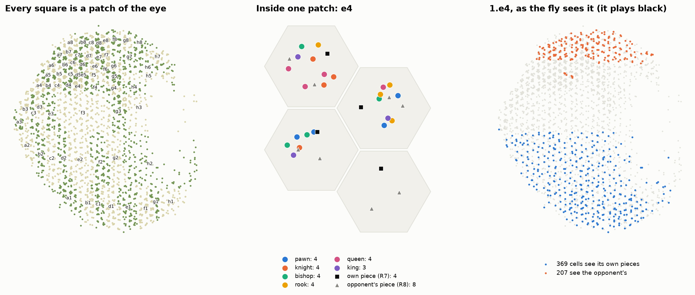
*Left: every square is one patch of the round eye. Middle: one patch up close, four columns (ommatidia) with their cells. Right: the position after 1.e4 as the fly sees it, blue for the cells that report its own pieces, orange for the opponent's. The lonely orange spot is the pawn on e4, which the mirrored board puts on e5.*

Inside a square's patch:

- R1 to R6 cells are shared out between the six piece types ("pawn here", "knight here", ...),
- R7 cells light up for the fly's own pieces,
- R8 cells for the opponent's.

The fly always plays "white": when it's black to move the board is mirrored first, so the same neurons handle both colours.

### The signal spreads for 12 steps

Every neuron has a rate between 0 and 1. Each step, all of them at once:

```
u     = W @ rate + eye                      everything arriving at the neuron
z     = gain * (u - mu[step]) / sd[step] + bias    homeostasis, then its own gain and bias
rate  = 0.5 * rate + 0.5 * relu(tanh(z))   squash to 0..1, move halfway there
```

With numbers, for a central brain neuron at step 6 whose usual input is `mu = 0.21` with spread `sd = 0.06`, and `gain = 0.5`, `bias = 0.3`: if this board gives it `u = 0.27`, then `z = 0.5 * (0.27 - 0.21) / 0.06 + 0.3 = 0.8`, `tanh(0.8) = 0.66`, and from a rate of 0.4 it moves to `0.5 * 0.4 + 0.5 * 0.66 = 0.53`. A board that gives it the usual 0.21 only pulls it towards `relu(tanh(0.3)) = 0.29`, so it drops to 0.35 instead. That difference is the information.

The halfway step (the leak) keeps things smooth, so the signal flows instead of flickering. Here is one think, the backprop fly answering 1.e4, one picture per step. At step 1 only the photoreceptors know about the board, the optic lobes answer at step 2, the descending neurons get their first trace at step 3 (the 2-synapse shortcut from the eye) and a real signal from step 5, and from step 7 on the mushroom body moves more than anything else.

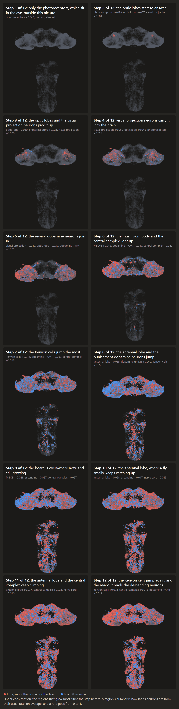

*Every dot is a neuron at its real position, brain on top, nerve cord below, drawn by the same code as the brain card in the app ([tools/brain_grid.py](tools/brain_grid.py)). Each caption says what's new at that step, read off the numbers under it: the regions whose firing changed most since the step before.*

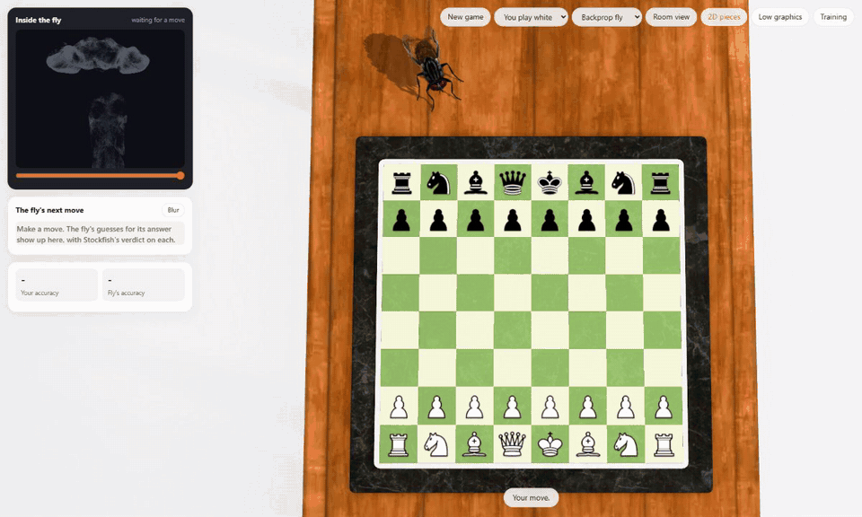
*The same move in the earlier 3D version of this project. I play e4, the brain panel at the top left replays the 12 steps, then the fly flies over and carries its knight to f6, and the panel ends on what it expects me to play. The room is gone now ([why](#playing-against-it)), the brain behind it is the same.*

**Why 12 steps?** Because by then it's done. I ran the brain for 20 steps instead, with homeostasis calibrated for all 20, and measured how much the board changes each region's firing ([tools/readout_lab.py](tools/readout_lab.py) `beyond`):

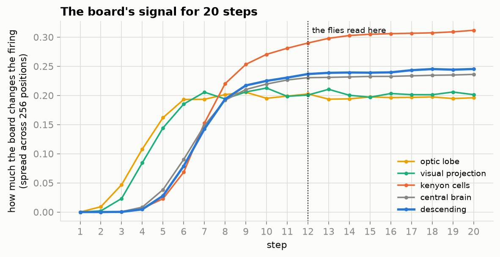

The optic lobes are done by step 6, the central brain and the descending neurons by about step 11: at step 12 the descending neurons carry 0.237 of the 0.245 they reach at step 20. Nothing fades either, homeostasis keeps every step at full volume, and only the Kenyon cells keep creeping up. So 16 steps would cost a third more compute for 3% more signal at the legs. Whether a readout could do anything with those 3% I haven't measured yet.

### Descending neurons make the move

A move is a from-square, a to-square and sometimes a promotion. Small readouts turn the 1,314 descending neurons into 64 from-scores, 64 to-scores and 5 promotion scores (none, queen, rook, bishop, knight). A move's score is the sum of its three, and **only legal moves get a score**, so the fly can't play an illegal move, only a bad legal one. A fourth readout guesses how good the position is, -1 to 1.

Softmax turns the scores of the legal moves into the percentages you see in the interface:

```
p(move) = exp(score(move)) / sum of exp(score) over all legal moves
```

Scores 2.1 for e4, 0.3 for d4 and -0.5 for everything else (18 moves) give `exp(2.1) = 8.2`, `exp(0.3) = 1.3`, `18 * exp(-0.5) = 10.9`, so e4 gets `8.2 / 20.4 = 40%`.

Those readouts are the only part that isn't the fly: 1,314 x 134 numbers, next to 6.2 million connection strengths inside.

## The model in TensorFlow

All of it is in [flychess/model.py](flychess/model.py).

Putting a connectome inside a neural network isn't my idea. Two Nature papers from 2024, both built on FlyWire (the female fly's connectome, the project before MaleCNS), showed that it works. Lappalainen and colleagues wired a model of the fly's eye exactly like the connectome, let backprop tune only the strengths, trained it to see motion, and its cells ended up tuned the way the real ones measure. Shiu and colleagues simulated the whole brain from the wiring alone, no training at all, and it predicted which neurons make a fly feed or groom. This project takes the first one's rule (the wiring and the signs are fixed, only strengths learn) and points it at chess.

<p>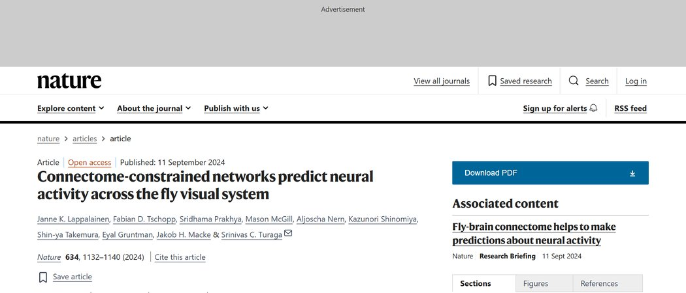 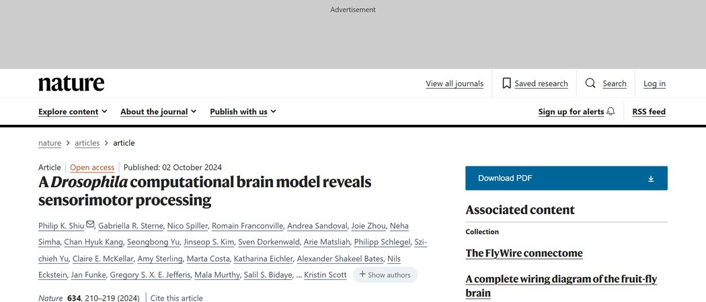</p>

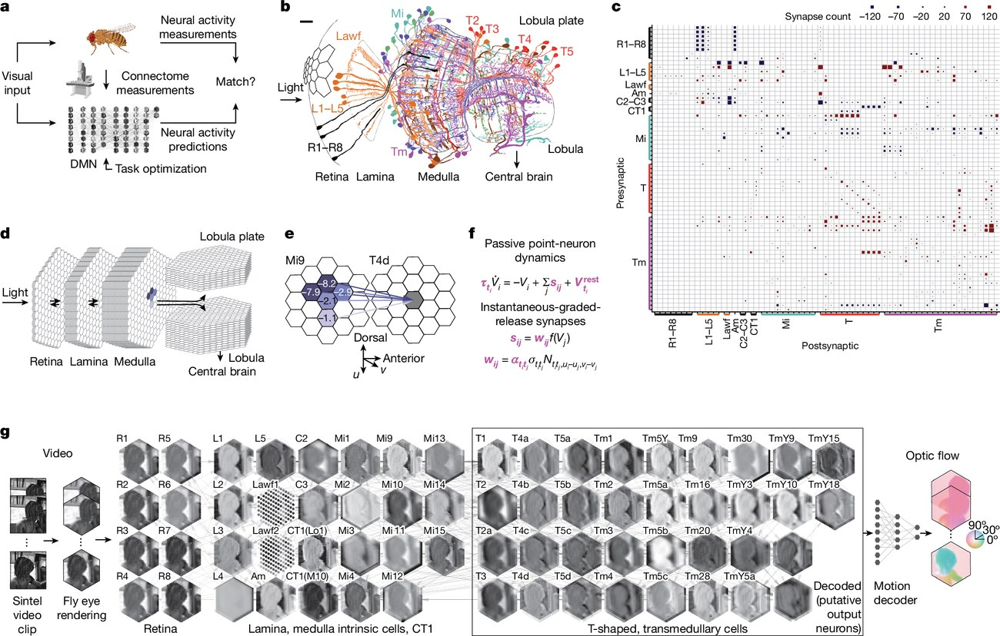
*The connectome-constrained model of the fly's eye: the wiring comes from the connectome (b, c), each cell is a simple unit with fixed sign and learnable strength (e, f), and a video goes in at the retina (g). Lappalainen et al., Nature 2024, CC BY 4.0.*

### The weights

```python
W = sign * softplus(theta)
```

`sign` is +1 or -1 per connection from the transmitter table and never changes. `theta` is one trainable number per connection, and `softplus` makes it positive, so a synapse can get stronger or weaker but an excitatory one can never turn inhibitory, and connections the fly doesn't have never appear. `theta` starts from the synapse count (log scale, as a share of everything the neuron receives), so before any training the model *is* the measured brain.

### Sparse, because a brain is mostly empty

163,803 neurons would be a 163,803 x 163,803 matrix, 27 billion numbers. Each neuron talks to a few dozen others, so `W` is a `tf.sparse.SparseTensor` with 6.2 million entries and every step is one `tf.sparse.sparse_dense_matmul`.

### A hand-written backward pass

TensorFlow can work out the gradient of a sparse multiply itself, but its version builds a temporary tensor of size connections x batch: 6.2 M x 64 floats, 1.6 GB, at every one of the 12 steps. So `unroll()` writes backprop through time out by hand with `tf.custom_gradient`. Here are its lines, the comments are what each one does:

```python
for t in reversed(range(steps - window, steps)):
    th = tf.tanh(zs[t])
    g_z = g * leak * tf.where(zs[t] > 0, 1 - th * th, 0.0)     # back through relu(tanh(z))
    g_gain += tf.reduce_sum(g_z * (us[t] - mu[t]) * inv_sd[t], 1, keepdims=True)
    g_bias += tf.reduce_sum(g_z, 1, keepdims=True)
    g_u = g_z * gain * inv_sd[t]                               # back through the homeostasis
    g_x += g_u                                                 # the eye feeds every step
    g_w += connection_grads(g_u, rates[t], post, pre)          # blame for every connection
    g = (1 - leak) * g + tf.sparse.sparse_dense_matmul(W, g_u, adjoint_a=True)  # one step back in time
```

`connection_grads` is the interesting one. The gradient of one connection is

```
d loss / d W[post, pre] = sum over the batch of (error at post) x (rate of pre)
```

so a connection should get stronger if the neuron it feeds needed more drive and the neuron it comes from was active. Remember that sentence, it comes back in the biological version. [tests/test_gradient.py](tests/test_gradient.py) checks all of this against TensorFlow's own autodiff on a small random brain, so the hand-written version can't quietly drift.

## The data

**Where it comes from.** The original version streamed the [Lichess evaluation database](https://database.lichess.org/#evals): positions from real games, analysed by Stockfish, with up to 5 candidate moves each. It's 22.4 GB but streams at about 50,000 positions a second, so it never needs saving. The catch the research turned up: the start of the file has about twice as many endgames as the rest, and I only ever read the start.

So the default is now [ChessBench](https://huggingface.co/datasets/prdev/chessbench-full-policy-value) (from DeepMind's "Grandmaster-level chess without search"): positions from real Lichess games where Stockfish 16 gave the chance of winning after **every legal move**. Six 72 MB files give 3,089,816 positions.

<p>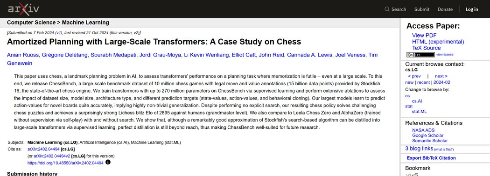 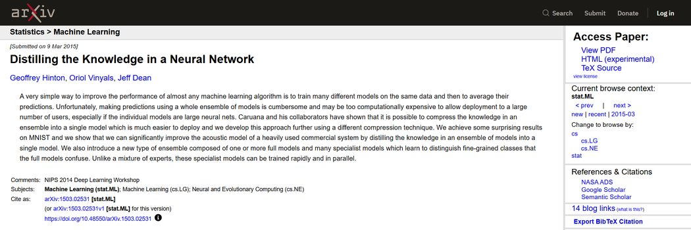</p>

**What a training example is.** The board as 768 bits, the list of legal moves (34.7 on average), Stockfish's 8 best moves with their win%, and how good the position is. `--prepare` packs 3 million of them into 973 MB once, on all 16 cores, so training never touches python-chess.

**Shuffle it.** The ChessBench files are sorted. My first held-out set was the first 4,096 rows, and the same model scored 7.6% top-1 there and 13.1% on random rows. Now the rows are shuffled before packing.

## Cheats: learning fast on a laptop

The first version would have needed about a day per pass over 10 million positions, and as it turned out, it wasn't learning anyway. These are the tricks, in the order they matter.

### 1. Wake the brain up first

Homeostasis, as above. Without it nothing else on this list matters.

### 2. Only compare legal moves

The old loss was a 64-way softmax over every square, so the fly also had to learn which squares are even legal. Now the softmax only runs over the legal moves of each position, the same thing AlphaZero and Leela Chess Zero do. That alone is worth a lot: a "fly" that never looks at the board and only learns which from/to squares are popular already gets **11.7%** top-1 once it's told which moves are legal. I call that the blind baseline and every number below is compared to it.

### 3. Learn Stockfish's whole opinion

Instead of "the best move is e4" (a one-hot target), every candidate gets a share by how much winning chance it gives away:

```
share(move) = exp((win%(move) - win%(best)) / TAU),   then divide by the sum,   TAU = 2.5
```

With the best move at 54 win%, a move at 52.5 gets `exp(-1.5 / 2.5) = 0.55`, one at 49 gets `exp(-5 / 2.5) = 0.14`. Normalised: 0.59, 0.32, 0.08. This is knowledge distillation (Hinton et al. 2015): the "dark knowledge" in which wrong answers are almost right is worth more than the label alone. In ChessBench 41% of positions have a second-best move within 1 win% of the best, so a one-hot target would be a coin flip half the time.

### 4. Fit the readout first

LP-FT (Kumar et al. 2022): first run the untouched brain over 50,000 positions once, keep what the descending neurons did, and fit only the readout on that (a linear probe). That takes about 2 minutes, because no backward pass is needed and the features are reused for 8 epochs. Only then does the real training start, from a readout that already makes sense. If you train the whole brain from a random readout, the random readout's errors flow back and wreck the brain's features first.

### 5. Let the brain be, train the readout

This one surprised me. After the probe I let backprop train everything: the 6.2 million connection strengths, every neuron's gain and bias, and the readout, each with its own Adam and learning rate. The fly got *worse*, every single time. So I logged the loss on held-out positions next to top-1 and tried again, smaller and smaller:

| What learned (after the probe) | Learning rates | Step 0 | Step 250 | Step 500 | Speed |
|---|---|---|---|---|---|
| everything, backprop through 6 steps | 1e-3 | 15.3% | | 10.2% | 205/s |
| everything, 6 steps | readout 1e-4, brain 3e-5 | 17.8% (loss 3.043) | 12.5% (3.108) | 12.8% (3.101) | 217/s |
| everything, all 12 steps | readout 1e-4, brain 3e-5 | 17.5% | 15.6% (3.048) | | 155/s |
| **readout only, brain as measured** | readout 1e-4 | 17.5% (3.043) | **18.5% (3.003)** | **18.8% (2.987)** | **352/s** |

*Top-1 on 2,048 held-out positions, the held-out loss in brackets (lower is better).*

The held-out loss went *up* while the brain trained, so it wasn't top-1 being picky, the fly really got worse at its own objective. My best guess: homeostasis divides every input by how much it usually varies, which makes the brain very sensitive, and Adam moves every one of the 6.2 million connections by about the learning rate on every step however small its gradient. Millions of tiny coordinated nudges add up to a different brain, faster than the readout can follow. Backpropagating through all 12 steps hurt less than through 6, so the truncation is part of it but not all.

Meanwhile the readout alone kept improving, and without a backward pass through the brain it runs 2.3x faster. So that's the default now: the brain stays exactly as measured (after homeostasis), and only the readout learns, from a stream of fresh positions. Machine learning has a name for this: reservoir computing. The fly's wiring is a fixed, recurrent "reservoir" that turns a board into a pattern of activity, and a simple readout learns to read moves out of it. The research I read points the same way: another MaleCNS chess project found its per-connection gains barely moved (median 0.99) after millions of positions.

Training the brain is one flag away (`--lr-synapses 1e-5 --lr-neurons 1e-5`), and all the backprop machinery below still runs when you set it. It's what I'd try on a long cloud run.

The learning rate warms up over the first 3% of the run, then follows a cosine down to zero exactly when your time is up (`--minutes`).

### 6. Make every step cheaper

I benchmarked every piece of one training step on the RTX 4060 (batch 64):

| Piece | Before | After |
|---|---|---|
| sparse forward, per brain step | 13.4 ms | 13.4 ms (cuSPARSE CSR 14.3, float16 12.5, XLA segment-sum 24.9: none better) |
| backward through the neurons | 13.3 ms | 13.3 ms |
| weight gradient | 48 ms (chunked gathers) | **4.9 ms** (one XLA kernel) |
| steps backprop walks back through | 12 | 6 (truncated backprop through time) |
| **positions per second, training the brain** | **about 71** | **225** |
| positions per second, readout only (the default) | | 352 |

The weight gradient was 80% of the time. With `@tf.function(jit_compile=True)` XLA fuses the two gathers and the sum into a single pass over the connections, so the 1.6 GB temporary is never built. Truncating backprop to the last 6 of 12 steps loses little because the brain is shallow: almost every neuron is within 3 hops of a descending neuron, so the last 6 steps still reach nearly every connection.

### 7. Read your own logs honestly

Each run logs top-1 next to the blind baseline, and also a "good move" rate: the fly's pick is within 1 win% of Stockfish's best. Chess is full of ties, and top-1 against one specific move undersells a fly that picks an equally good one.

### 8. Train in the cloud with the laptop closed

[notebooks/train_on_kaggle.ipynb](notebooks/train_on_kaggle.ipynb) runs the whole thing on Kaggle's free GPUs. Upload it, turn on the GPU (P100) and internet, press **Save & Run All (Commit)** and close the laptop: commits run on Kaggle's machines for up to 12 hours (about 30 GPU hours a week are free). A P100 has about 3x the memory bandwidth of my laptop's GPU (732 GB/s against 256), and this model is all memory traffic, so I'd expect an hour there to be worth about three here. I haven't measured that. It downloads and prepares everything itself, leaves `checkpoints/` and `runs/` in the output tab, and a new session picks up where the last one stopped if you attach the old output. Right now it's set up as the control for the day-long fly: the same recipe on the shuffled brain. Modal's free $30 a month is the other option if you want an A100.

Two Kaggle GPUs (T4 x2) would need `tf.distribute.MirroredStrategy`. The hand-written backward pass and the sparse brain work under it ([tests/test_mirrored.py](tests/test_mirrored.py): two replicas on half a batch each give the same gradient as one on all of it), but the training scripts use one GPU, and one P100 has more bandwidth than two T4s together would bring (2 x 320 GB/s, minus the cost of keeping them in step).

### 9. A day on a laptop, measured first

Before leaving it to train for a day I measured where a day would go ([tools/bench.py](tools/bench.py)). The frozen brain's forward pass is all a readout-only run does, so that's the number that matters:

| Batch | Forward, 12 steps | Positions per second | GPU busy |
|---|---|---|---|
| 16 | 42 ms | 379 | 55% |
| 32 | 83 ms | **387** | 94% |
| 64 | 182 ms | 351 | 99% |
| 128 | 365 ms | 350 | 93% |
| 256 | 733 ms | 349 | 95% |
| 512 | | refused: TensorFlow's GPU kernel stops at batch x connections = 2^31 | |

A bigger batch buys nothing. Every step multiplies 6.2 million connections by every position in the batch, and that work is the same per position however you batch it: `6,234,868 x 128 x 8 bytes = 6.4 GB` per step, which at about 210 GB/s is 30 ms, times 12 steps is the 365 ms in the table. Batch 32 is 10% faster, probably because its 21 MB of rates fit in the GPU's 24 MB L2 cache and 128's 84 MB don't. Picking and unpacking a batch on the CPU takes 0.1 to 0.3 ms, so feeding the GPU in the background (`tf.data` with prefetch) would win nothing either.

Two more things I measured and left alone. Training the brain too (the full step, the backward pass through 6 steps and Adam) runs at 194, 212, 220 and 217 positions a second for batch 32, 64, 128 and 256, so the brain learning costs about 40% of the speed. And renumbering the neurons so that connected ones sit closer in memory (reverse Cuthill-McKee, which brings the median distance between a connection's two neurons from 31,770 down to 19,314) makes the forward pass 4% faster: 401 positions a second at batch 32. Not worth renumbering a whole brain for.

So 350 positions a second it is, 30 million a day. The trick is to not spend them on the same positions twice: with the brain frozen, a position's descending neurons do the same thing every time, so the brain only has to run once per position. Keep their rates as bytes (1,314 per position, 1.3 GB per million) and the readout can go over them as often as it likes in seconds instead of hours ([tools/readout_lab.py](tools/readout_lab.py)).

That also answers the question a day of training is really about: does the fly still get better with more positions? I ran the brain once over 500,000 of them and fitted a fresh readout on more and more of those, every time until the loss on the VAL positions stopped falling:

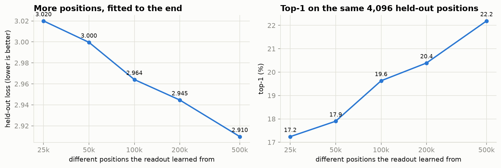

Every doubling of the positions still takes about 0.026 off the held-out loss, and it isn't flattening at 500,000. Fitted to the end, 200,000 positions already beat the 25-minute fly that streamed past 527,000 once (2.945 against 2.963), and 500,000 get to 22.2% top-1. So the day goes to positions, not to passes: [flychess/train_cached.py](flychess/train_cached.py) runs the brain once over all 3.09 million downloaded positions (about 2.5 hours), fits the readout on that, then keeps downloading more ChessBench files and running the brain over them for the rest of the day, fitting again every 6 hours. The next file downloads while the GPU works on the last one. The fit reads the rates back a block of 262,144 positions at a time, the next block loading from the disk (about 200 MB/s) while the GPU trains on this one, so neither the GPU nor WSL ever holds more than about a gigabyte of them. My first version put all 4 GB on the GPU at once: the first try ran the GPU out of memory, because filling a slice of a TensorFlow variable reads the whole variable first, and the second took the whole of WSL down with it, two hours into the run.

## How backprop works here

No maths beyond "slope" needed.

1. **Guess.** Show the fly a position. It gives every legal move a probability.
2. **Measure how wrong.** The loss is `-sum(share x log p)` over the legal moves: if Stockfish gives e4 0.59 and the fly gives it 0.05, that term is `-0.59 x log(0.05) = 1.77`. If the fly agreed perfectly, it would only be left with the target's own spread. The value readout is scored by squared error.
3. **Ask every weight which way to move.** The gradient says, for every number, "if I nudge this up a bit, does the loss go up or down, and how much". Backprop gets all of them in one backward pass with the chain rule: the loss depends on the move scores, the scores on the readout and the descending neurons, those on their inputs at step 12, those on other neurons at step 11, and so on back. The same weights are used at every step, so each connection collects blame from every step. That's backprop through time. By default the chain stops at the readout (176k numbers); with `--lr-synapses` it goes all the way into the brain (6.7 million).
4. **Nudge.** Adam moves every weight a little against its gradient, then the next batch of 128 positions, and again.

**Why the signs stay fixed.** Left alone, backprop would flip inhibitory synapses, invent connections and end up with a generic network that happens to have 163,803 units. `softplus` keeps it honest: it can only tune how strong each real synapse is.

**Why this isn't how a fly learns.** Every synapse would need to know the error at the output and how it travels back through everything after it. Real neurons can't send that backwards. Which is why there's a second version.

### Watching it learn

With the brain frozen, what the descending neurons do for a position never changes during training. So I can run the brain once per position, keep a copy of the readout every few hundred batches (`--snapshot-every 250`, 0.7 MB each), and replay afterwards what the fly would have answered at any point of its training ([tools/descent.py](tools/descent.py)). Here's a 10-minute run after 1.e4, from the newborn's random readout to the end:

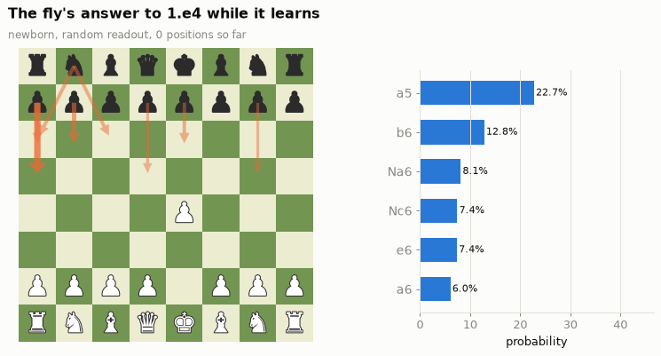

*105 snapshots, one per frame. The newborn's favourite is a5 (22.7%), because a random readout loves some squares for no reason. Early in the probe it's Nc6 and d5, by the end of it Nf6, and the 10 minutes of training on new positions mostly sharpen that: Nf6 21.4%, then d6, Nc6 and d5 at about 9% each.*

The readout has 176,000 numbers, so its loss lives in 176,000 dimensions and nobody can draw that. Li and colleagues found a way round it in 2018: the path gradient descent takes uses very few of those dimensions. Subtract the final weights from every snapshot, run a PCA, and the first two directions usually hold most of the movement. Here the first one alone holds 95% of it. So draw the loss on the plane of those two directions, and the path on top:

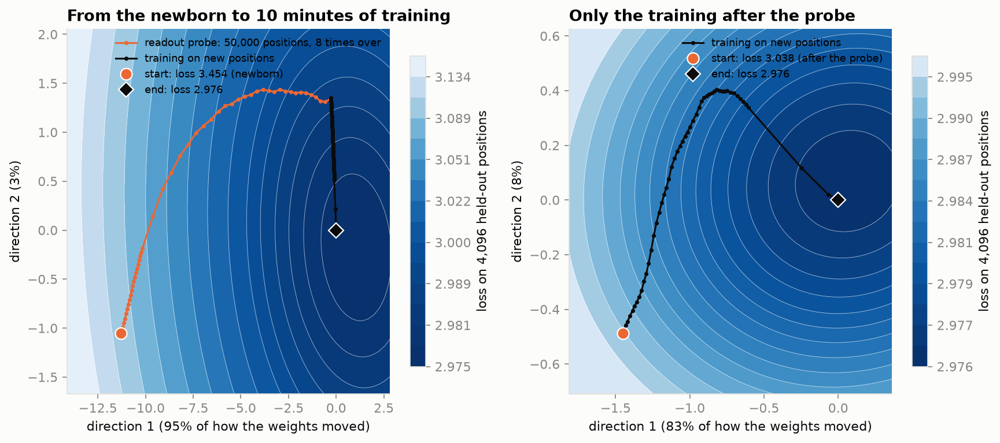

*The held-out loss on a 61 x 61 grid in the plane, with the path projected onto it. Because the brain is frozen, the move scores are linear in the readout's weights, so the whole grid is three precomputed arrays and a softmax per point, without running the brain again.*

What I didn't expect: the readout probe does almost all of the moving. Its 400,000 lessons (50,000 positions, 8 times over) take the loss from 3.454 to 3.038, and the 10 minutes on 191,000 new positions only from 3.038 to 2.976. And the end point sits right at the bottom of both planes: the lowest point in either is only 0.0009 lower. Whatever comes next has to come from the other 176,000 directions, or from more data.

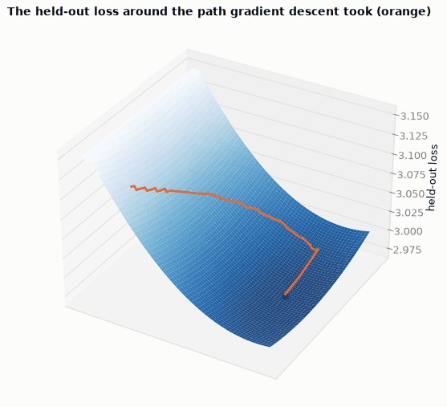

<p>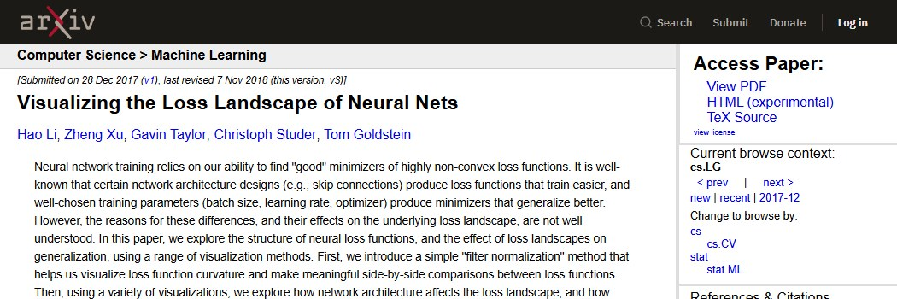 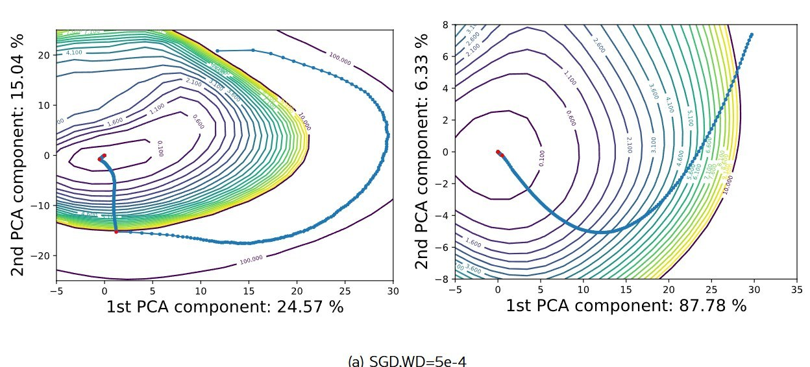</p>

*Li, Xu, Taylor, Studer and Goldstein, [Visualizing the Loss Landscape of Neural Nets](https://arxiv.org/abs/1712.09913), NeurIPS 2018. Right: their figure 9a, the same picture for a VGG-9 on CIFAR-10, small batches on the left, big ones on the right.*

### Watching the error go back

Backprop through time sounds abstract, so here it is on the brain. Same position as [the 12 steps](#the-signal-spreads-for-12-steps) (after 1.e4, the fly to move), same brain, but now the error runs backwards: TensorFlow works out `d loss / d input` for every neuron at every step, all 12 of them instead of the 6 training uses ([tools/bptt.py](tools/bptt.py)). Stockfish likes c5, e5, c6, e6 and d6 here, 46.9 to 45.2 win%, and the fly's favourite was Nf6, so the loss is 2.96 and there's plenty to blame.

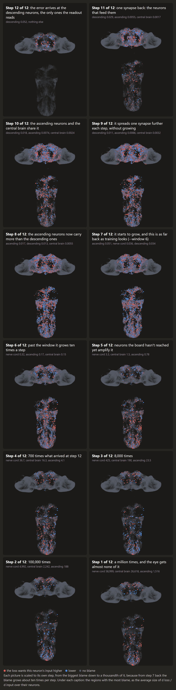

*The mirror image of the forward pictures, read from step 12 back to step 1. Red: the loss would go down if this neuron got more input, blue: less.*

The surprise is the size. From step 12 back to step 8 the blame spreads one synapse per step and stays about the same, around 0.01 per neuron. From step 7 back it grows about ten times per step, and at step 1 the nerve cord gets a million times more than arrived at the descending neurons, while the eye, the one place the board actually comes in, gets almost none.

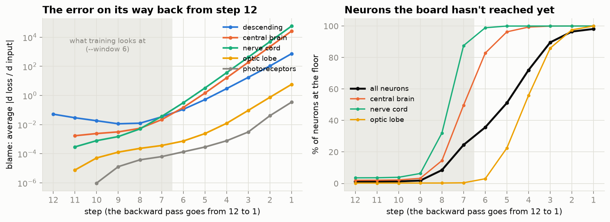

It's homeostasis again. At step 3 the board hasn't reached most of the brain yet, so during calibration those neurons got exactly the same input for every board, a spread of zero. The floor turns that into the biggest gain there is. Going back through one neuron:

```
g_u = g * leak * (1 - tanh(z)^2) * gain / sd
```

For a nerve cord neuron at step 3, `sd` is the floor 0.02 and `z` is just its bias 0.3, so `g_u = g * 0.5 * 0.91 * 0.5 / 0.02 = 11.4 * g`. Eleven times per step, the slope on the left chart. In the forward pass it never matters: those neurons get the same input for every board, so whatever they multiply is zero. Change one synapse, though, and their input moves, and they pass 11 times that on to the next step.

That's my best explanation for [cheat 5](#5-let-the-brain-be-train-the-readout), the fly getting worse every time its brain learned. With `--window 6` the gradient never sees steps 1 to 6 at all, but the forward pass still runs through them, so every synapse change makes the early steps jump in ways the gradient can't know about. It also points at a fix that changes nothing for the frozen brain, which is in [making it stronger without cheating](#making-it-stronger-without-cheating).

## The biological version

Everything is in [flychess/bio.py](flychess/bio.py) and [flychess/train_bio.py](flychess/train_bio.py). No gradients, no loss, no backprop.

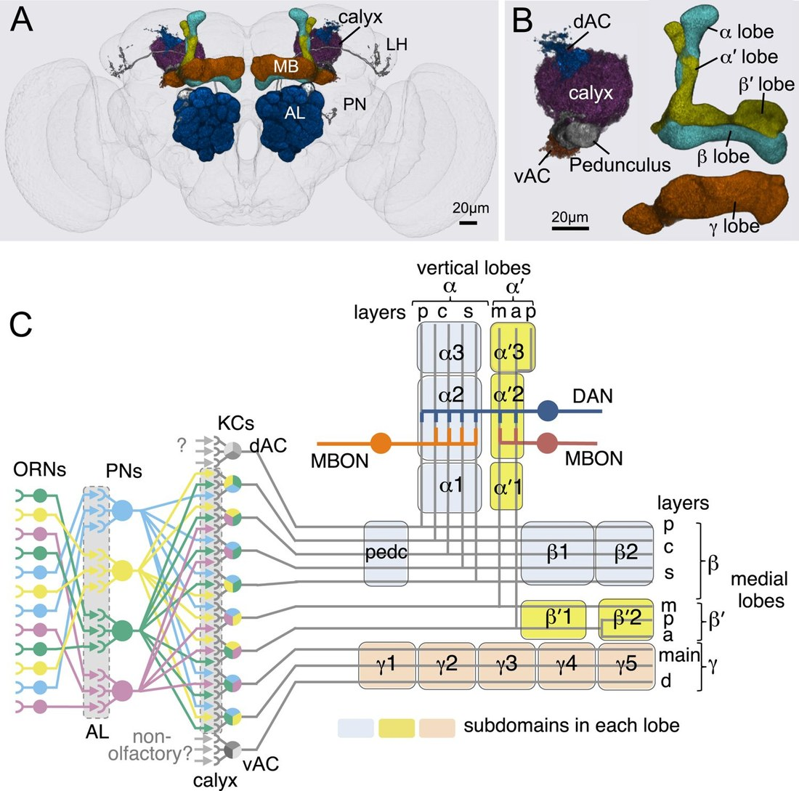
*The mushroom body and its circuit: smell receptors to projection neurons to Kenyon cells (KCs), which feed the output neurons (MBON), while dopamine neurons (DAN) reach each compartment. Aso et al., eLife 2014, CC BY 4.0.*

### How a real fly learns

The classic experiment: a fly smells odour A and gets a small shock, smells odour B and gets nothing. Later it avoids A. Inside:

1. Odour A activates a small, specific set of Kenyon cells.
2. They drive the MBONs, some of which lead to approach, some to avoid.
3. The shock fires punishment dopamine neurons (PPL1).
4. Dopamine arrives at the Kenyon cell to MBON synapses, and the ones whose Kenyon cell was just active get **weaker**, but only in the compartments PPL1 reaches, which are mostly approach MBONs.
5. Next time, odour A drives approach less, so avoid wins.

Reward works the same way through another dopamine group (PAM), which mostly reaches avoid MBONs. Three things must line up for a synapse to change: its Kenyon cell was active, dopamine arrived, and it sits in that dopamine neuron's compartment. All of it is available right there at the synapse. That's the difference from backprop.

### How this fly learns chess

Same five steps, with a position in place of a smell. For every legal move the fly looks at the position it would lead to, all of them at once as a batch, and the MBONs vote: approach MBONs count +1, avoid MBONs -1, and the move with the most approach wins. Which dopamine neuron reaches which MBON comes straight from the connectome, not from me, and so does which MBONs are approach: the ones the punishment dopamine (PPL1) reaches, because punishing something means turning its approach down. The ones the reward dopamine (PAM) reaches are avoid.

**A tutor instead of games.** Learning only from games means one result every 80 moves, too rare to tell which move was good, and playing a game a batch of 1 at a time is slow. So Stockfish plays the experimenter: the fly is shown the position after Stockfish's move and the position after some other legal move, and gets sugar (PAM) for the first and a shock (PPL1) for the second. The dose is the chance the fly would still pick the worse one, so things it already gets right stop teaching it. 64 lessons go through the brain at once. The old game mode is still there (`--games`).

**Only 5% of Kenyon cells.** Once the brain was awake, most Kenyon cells fired for every board (64% of them, on average), so every lesson overwrote the last one. Real flies keep it near 5% with one big inhibitory neuron (APL) that listens to all Kenyon cells and calms them down. The model does the same: only the 203 most active Kenyon cells pass their signal on.

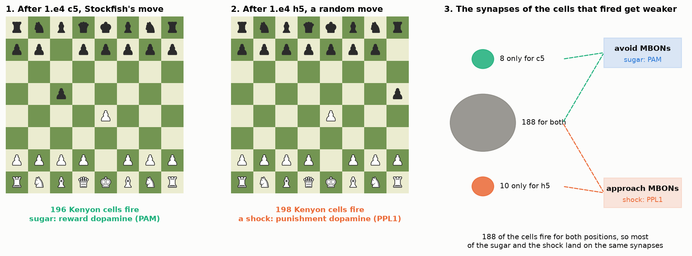
*One lesson, with the trained dopamine fly's own Kenyon cells. The fly plays black and smells the position after Stockfish's c5 and after a random h5. The problem is in panel 3: 188 of the roughly 200 cells that fire are the same for both positions.*

### The dopamine fly was a random number generator

My first dopamine run looked like the fly was learning backwards: 55% of the held-out pairs right at the start, then down to about 40%, worse than a coin flip. It wasn't learning backwards. It wasn't measuring anything. I scored the same 512 pairs twice, same weights, same positions, and **36% of the comparisons came out the other way round**.

The 5% cut did it. With a hard cut, a Kenyon cell right at the edge is either fully on or fully off, and a rounding difference in the GPU's sums decides which. That cell feeds the MBONs, the MBONs feed the rest of the brain, the brain feeds back into the Kenyon cells, and 12 steps later a rounding error is a different answer. The backprop fly never had this problem because it has no cut.

My first fix was to subtract the inhibition instead of cutting. It killed the noise, and the learning with it: the Kenyon cells were left with a fifth of the MBONs' input, so changing their synapses changed almost nothing. What works is a steep sigmoid instead of a step. Cells clearly above the cut pass at full strength, cells clearly below stay silent, and the few right at the edge fade in between, so rounding can't flip them.

| The 5% cut | Same pairs scored twice, comparisons that flip | How much the Kenyon cells move the MBONs, next to everything else |
|---|---|---|
| hard step (the first version) | 36% | 0.67 |
| subtract the inhibition | 3% | 0.19 |
| **steep sigmoid** | **6%** | **3.4** |

### Which rule teaches it

With the noise gone I could finally compare rules: all from the same untrained mushroom body, the same kind of lessons, scored on the same 512 held-out pairs ([tools/bio_rules.py](tools/bio_rules.py)).

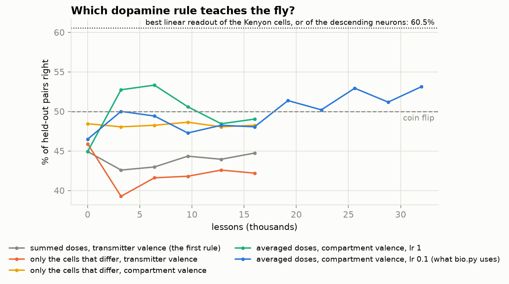

Two things decide it.

**Valence.** Going by transmitter (acetylcholine means approach, glutamate and GABA mean avoid), the fly learns *backwards*: the orange line drops from 46% to 39% and stays around 42%. PPL1's biggest target is MBON11, a GABA neuron, so I had it as avoid. But in real flies punishment works by turning exactly that neuron down, which only makes sense if it's an approach one. Aso and colleagues found the rule that holds across the whole mushroom body: an MBON's valence is the opposite of the dopamine that reaches it. Reading valence that way from the connectome flips 26 of the 97 MBONs, and learning goes the right way.

**The dose.** In the first version the doses added up over the 64 lessons of a batch instead of averaging, so they were 64 times too strong: a quarter of all the plastic synapses ended below half their strength and the score didn't move (grey). Averaged over the batch with a big learning rate (green), the fly jumps to 53% and then slides back as the synapses keep weakening. With a learning rate 10x smaller (blue) it climbs slower, and it's still climbing at 32,000 lessons: 53%. Tagging only the Kenyon cells that differ between the two positions, which sounded clever, did nothing (yellow).

One warning about this chart: the same untrained fly measures anywhere from 43% to 48% depending on the run, from the rounding noise that's left. So read anything under 3 points as nothing.

**How much is there to learn?** A logistic regression that sees every Kenyon cell, trained on 16,384 pairs, gets 60.5% of the held-out pairs right. That's the dotted line, the best I got out of any linear readout of these cells, and the dopamine rule is a very restricted linear readout (it can only weaken synapses, only in whole compartments). So the mushroom body does see something about which move is better, and dopamine gets the fly about half of the way from where it starts to that line. A logistic regression on the descending neurons also gets 60.5%, so on this test they don't know more than the Kenyon cells do. The backprop fly's edge is its teacher: gradients over half a million positions instead of one rule that can only weaken synapses.

### Fifteen minutes of lessons

With that rule, `python -m flychess.train_bio --minutes 15` gives the fly 114,816 lessons, and on 1,024 held-out pairs it goes from 48.7% to 53.3%:

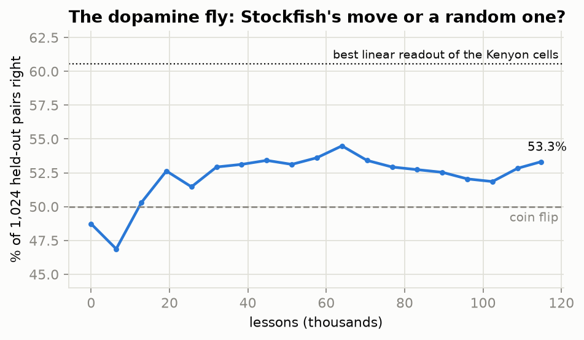

Real, but small. Most of it comes in the first 20,000 lessons, then it sits around 52 to 54% for the rest of the run. Picking its favourite of all the legal moves, it finds Stockfish's move 4 to 6% of the time on 300 positions, before and after training, where a random pick gets 3%. So better pairs haven't turned into better moves yet. In games it's a bit behind the backprop fly: 2 wins, 17 draws and a loss against the random mover, 15 draws and 5 losses against greedy, and nothing against Stockfish ([the table](#measuring-strength)).

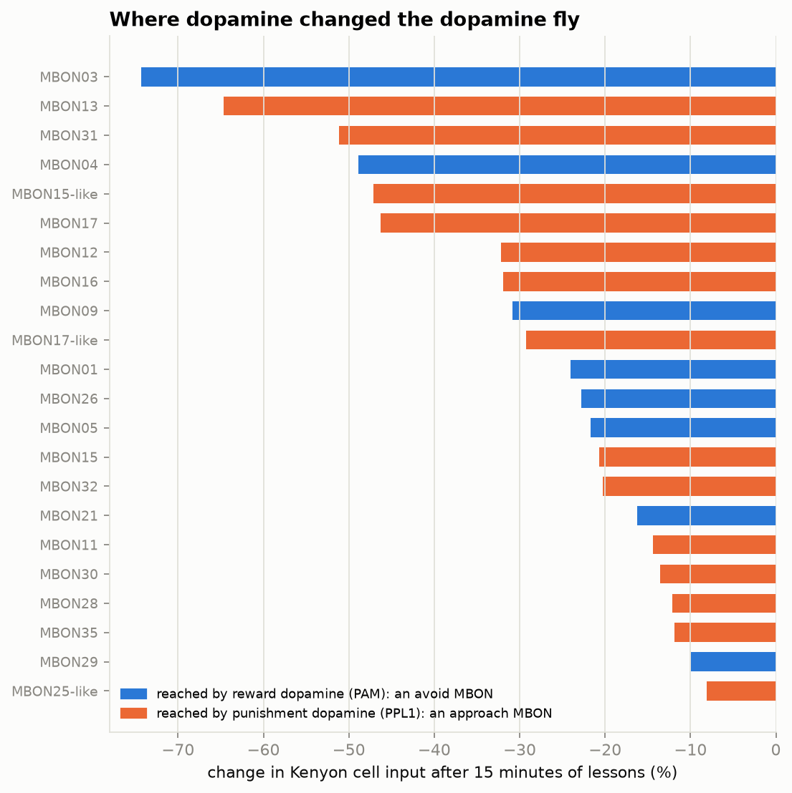
*How much each MBON type's input from the Kenyon cells changed over those 15 minutes (the 22 that changed most). The rule can only weaken, so everything is negative. MBON03, an avoid MBON, lost 74% of its input.*

The lesson comic shows why the dopamine fly learns so little. Two positions one move apart differ in a pawn and nothing else, and the Kenyon cells, the cells whose whole job in a real fly is to give every smell its own pattern, answer both with almost the same one: 196 cells for c5, 198 for h5, 188 in both. The sugar for c5 weakens those 188 cells' synapses onto the avoid MBONs, the shock for h5 weakens the same 188 cells' synapses onto the approach MBONs, and only 8 and 10 cells carry anything that tells the two apart. A fly's olfactory system spends a lot of wiring on keeping similar smells apart. For chess positions that differ by one pawn, this one doesn't manage.

The honest scoreboard: the backprop fly reads chess out of the same brain far better. What the dopamine fly shows is that the biological rule does push the right way, once the fly's own wiring decides which MBONs mean approach and the 5% cut stops turning rounding errors into answers. When I started, it didn't do either.

## The maths

Everything here is what the code computes, with the constants it uses. A bold letter is one number per neuron (or per square, or per move), $`\odot`$ multiplies two of them number by number, and a batch of positions is only more columns: where I write one position, the code does the same for every position in the batch and averages the losses. $`\log`$ is the natural log.

### 1. Wiring the brain

From [flychess/connectome.py](flychess/connectome.py) and [flychess/model.py](flychess/model.py). Neuron $`i`$ connects to another neuron $`j`$ if the tables have at least 5 synapses $`n_{ji}`$ between them. The sign of the connection comes from what the sending neuron releases ([which sign](#the-connectome)):

```math
\epsilon_i =
\begin{cases}
+1 & i \text{ is a photoreceptor}\\
-1 & \text{GABA, glutamate or histamine}\\
+1 & \text{anything else: acetylcholine, dopamine, serotonin, octopamine}
\end{cases}
```

The transmitter is the consensus call, else the cell type's prediction, else the neuron's own, and acetylcholine if none of them says. Only the strength of a connection can learn, never its sign ([the weights](#the-weights)):

```math
W_{ji} = \epsilon_i\, \mathrm{softplus}(\theta_{ji}),\qquad \mathrm{softplus}(\theta) = \log\bigl(1 + e^{\theta}\bigr) > 0
```

Before training, each connection's strength is its share of the log synapse counts the receiving neuron gets:

```math
\mathrm{softplus}\bigl(\theta^{0}_{ji}\bigr) = \max\Bigl(\frac{\log(1 + n_{ji})}{\sum_k \log(1 + n_{jk})},\ 10^{-4}\Bigr)
```

So the strengths of every neuron's inputs add up to 1, and a connection with 100 synapses is only about twice as strong as one with 10. $`W`$ is a sparse matrix with one row per receiving neuron: 6,234,868 entries out of $`163{,}803^2`$.

The control brains only change which connections there are, before $`\theta^0`$ is worked out. The shuffled brain hands the receiving ends of all the connections out again in a random order (and drops the few that land back on their own sender), and a lesion drops every connection whose sender is in the region that's cut out.

### 2. The board on the eye

From [flychess/encode.py](flychess/encode.py) and [flychess/io_maps.py](flychess/io_maps.py). A position is 12 planes of 64 squares, always from the side to move: when it's black's turn the board is mirrored first, ranks flipped and colours swapped.

```math
b_{p,q} = \mathbf{1}\{\text{piece } p \text{ stands on square } q\},\qquad q = 8 \cdot \text{rank} + \text{file}
```

Planes $`p`$ = 0 to 5 are the fly's own pawns, knights, bishops, rooks, queens and king, 6 to 11 the opponent's. A photoreceptor $`j`$ placed on the eye sits on one square $`q_j`$ and reports a set of planes $`F_j`$ there:

```math
F_j =
\begin{cases}
\{k_j,\ k_j + 6\} & \text{R1 to R6: one piece type } k_j \text{, either colour}\\
\{0, 1, 2, 3, 4, 5\} & \text{R7: any piece of the fly's}\\
\{6, 7, 8, 9, 10, 11\} & \text{R8: any piece of the opponent's}
\end{cases}
\qquad\qquad
x_j = \sum_{p \in F_j} b_{p, q_j}
```

So $`x_j`$ is 1 when its square holds a piece it reports and 0 otherwise, every neuron that isn't a placed photoreceptor gets $`x_j = 0`$, and the eye sends the same $`\mathbf{x}`$ at every step. The R1 to R6 cells of a square take the piece types in turn, $`k_j = (\text{R1 to R6 cells placed on that square before } j)\ \mathrm{mod}\ 6`$ on the fair eye; the first eye took them in turn over the whole list of photoreceptors instead.

Each photoreceptor takes the eye column $`(h_1, h_2)`$ (hex1, hex2) of the labelled cell it makes the most synapses onto. The first eye cut the two coordinates separately, with $`o(h)`$ the place of $`h`$ when all $`N`$ placed photoreceptors are sorted:

```math
\text{file}_j = \min\Bigl(\Bigl\lfloor \frac{8\, o(h_{1,j})}{N} \Bigr\rfloor,\ 7\Bigr),\qquad
\text{rank}_j = \min\Bigl(\Bigl\lfloor \frac{8\, o(h_{2,j})}{N} \Bigr\rfloor,\ 7\Bigr)
```

The fair eye ([why](#the-board-goes-in-through-the-eye)) cuts columns $`c`$ in the turned coordinates $`u = h_1 - h_2`$ and $`v = h_1 + h_2`$, where the eye is round, and weighs every column by its cells: $`\omega_c`$ counts 1 for each R1 to R6 cell and 0.1 for each R7 or R8. Sorted along $`v`$, the columns go into 8 bands of equal weight, and every band, sorted along $`u`$, into 8 squares of equal weight:

```math
\text{rank}_c = \min\Bigl(\Bigl\lfloor 8\, \frac{\sum_{c' \in \mathcal{B}_v(c)} \omega_{c'}}{\sum_{c'} \omega_{c'}} \Bigr\rfloor,\ 7\Bigr),\qquad
\text{file}_c = \min\Bigl(\Bigl\lfloor 8\, \frac{\sum_{c' \in \mathcal{B}_u(c)} \omega_{c'}}{\sum_{c' \in \text{band}} \omega_{c'}} \Bigr\rfloor,\ 7\Bigr)
```

where $`\mathcal{B}_v(c)`$ is the columns that come before $`c`$ sorted by $`v`$ (then $`u`$), and $`\mathcal{B}_u(c)`$ the columns of its band that come before it sorted by $`u`$ (then $`v`$). Every cell of a column gets the column's square.

### 3. Twelve steps

From [flychess/model.py](flychess/model.py) (`FlyBrain`). Every neuron has a rate between 0 and 1, all of them start at $`\mathbf{r}^{(0)} = 0`$, and each step $`t`$, from 1 to 12, updates all of them at once ([in words](#the-signal-spreads-for-12-steps)):

```math
\begin{aligned}
\mathbf{u}^{(t)} &= W \mathbf{r}^{(t-1)} + \mathbf{x}\\
\mathbf{z}^{(t)} &= \boldsymbol\alpha \odot \frac{\mathbf{u}^{(t)} - \boldsymbol\mu^{(t)}}{\boldsymbol\sigma^{(t)}} + \boldsymbol\beta\\
\mathbf{r}^{(t)} &= (1 - \lambda)\, \mathbf{r}^{(t-1)} + \lambda \max\bigl(0,\ \mathrm{tanh}\, \mathbf{z}^{(t)}\bigr)
\end{aligned}
```

- $`\mathbf{u}`$ is everything arriving at each neuron: its inputs' rates through the connections, plus the eye.
- $`\boldsymbol\mu^{(t)}`$ and $`\boldsymbol\sigma^{(t)}`$ are homeostasis: each neuron's usual input at this step, and how much it moves from board to board.
- $`\boldsymbol\alpha`$ and $`\boldsymbol\beta`$ are every neuron's own gain and bias. They start at 0.5 and 0.3 and only learn if `--lr-neurons` says so.
- $`\lambda = 0.5`$ is the leak: every step the rate moves halfway towards $`\max(0, \mathrm{tanh}\, z)`$, the code's `relu(tanh(z))`.

Homeostasis is measured once, before any training and without any targets ([why](#the-fly-was-brain-dead)). 256 positions go through the 12 steps, and at every step each neuron's input is averaged over them:

```math
\mu^{(t)}_j = \frac{1}{256} \sum_{b=1}^{256} u^{(t)}_j(b),\qquad
\sigma^{(t)}_j = \max\left(\sqrt{\frac{1}{256} \sum_{b=1}^{256} \bigl(u^{(t)}_j(b) - \mu^{(t)}_j\bigr)^2},\ 0.02\right)
```

Each step is normalised with its own numbers as soon as they're measured, so step $`t + 1`$ is measured on the brain as it will really run. Without the floor of 0.02, a neuron whose input never moves would be scaled up a thousandfold or more. It still gets the biggest gain there is, $`\alpha / 0.02 = 25`$, and with `--calm-unreached` a neuron whose input didn't move at all at that step (a variance under $`10^{-10}`$) gets $`\sigma = 1`$ instead ([why that matters](#watching-the-error-go-back)). On the brain as measured that changes nothing: such a neuron gets the same input for every board, so $`u - \mu = 0`$ either way.

| constant | value | | constant | value |
|---|---|---|---|---|
| steps | 12 | | leak $`\lambda`$ | 0.5 |
| starting gain $`\alpha`$ | 0.5 | | starting bias $`\beta`$ | 0.3 |
| floor on $`\sigma`$ | 0.02 | | "not reached" | variance $`< 10^{-10}`$ |
| calibration positions | 256 | | | |

### 4. From descending neurons to a move

From [flychess/model.py](flychess/model.py) (`FlyChess`) and [flychess/encode.py](flychess/encode.py) (`policy`). The readout sees the 1,314 descending neurons, averaged over the steps $`\mathcal{R}`$ it reads: $`\{12\}`$ for the first flies, $`\{9, 10, 11, 12\}`$ for the day-long fly.

```math
\mathbf{d} = \frac{1}{\lvert \mathcal{R} \rvert} \sum_{t \in \mathcal{R}} \mathbf{r}^{(t)}_{\text{DN}}
```

Four linear readouts turn them into 64 from-square scores, 64 to-square scores, 5 promotion scores (none, queen, rook, bishop, knight) and a value:

```math
\begin{aligned}
\mathbf{y}^{\text{from}} &= K^{\text{from}} \mathbf{d} + \mathbf{c}^{\text{from}}, &
\mathbf{y}^{\text{to}} &= K^{\text{to}} \mathbf{d} + \mathbf{c}^{\text{to}},\\
\mathbf{y}^{\text{pr}} &= K^{\text{pr}} \mathbf{d} + \mathbf{c}^{\text{pr}}, &
v &= \mathrm{tanh}\bigl(\mathbf{k}^{\text{val}} \cdot \mathbf{d} + c^{\text{val}}\bigr)
\end{aligned}
```

That's 1,314 × 134 weights and 134 biases, 176,210 numbers in all, and along with homeostasis the only numbers in the model that aren't the fly's. A move $`m`$ is a from-square, a to-square and a promotion (in the mirrored frame when the fly is black). Its score is the sum of its three, and softmax runs over the legal moves $`\mathcal{L}`$ only ([in words](#descending-neurons-make-the-move)):

```math
s(m) = y^{\text{from}}_{\text{from}(m)} + y^{\text{to}}_{\text{to}(m)} + y^{\text{pr}}_{\text{pr}(m)},\qquad
P(m) = \frac{e^{s(m)}}{\sum_{m' \in \mathcal{L}} e^{s(m')}}
```

There's no temperature: $`P`$ is exactly the percentages the interface shows, and an illegal move never gets a score at all. The fly plays the legal move with the highest $`P`$ that doesn't bring back an earlier position of the game (if every move does, the highest anyway). In training, a position's legal moves are a list padded to 96, the padding scores $`-10^9`$, and the positions with more than 96 legal moves, about 1 in 1,000, are skipped.

### 5. The loss

From [flychess/train_dl.py](flychess/train_dl.py) (`target`, `losses`) and [scripts/download_chessbench.py](scripts/download_chessbench.py). ChessBench has Stockfish 16's chance to win after every legal move. The data keeps the best $`K \le 8`$ moves, $`c_1`$ to $`c_K`$ from the best down, with their chances $`\mathrm{win}_k`$ in percent (rounded to 0.1), and the target shares them out by how much winning chance each one gives away ([cheat 3](#3-learn-stockfishs-whole-opinion)):

```math
q(c_k) = \frac{e^{(\mathrm{win}_k - \mathrm{win}_1)/\tau}}{\sum_{k'=1}^{K} e^{(\mathrm{win}_{k'} - \mathrm{win}_1)/\tau}},\qquad \tau = 2.5,\qquad q(m) = 0 \text{ for every other legal move}
```

So a move 2.5 win% worse than the best gets $`1/e`$ of the best move's share. The value readout learns the best move's chance, turned into $`[-1, 1]`$:

```math
y = \frac{2\, \mathrm{win}_1}{100} - 1
```

The loss of a position is the cross-entropy over the legal moves plus the value's squared error, weighted the same, averaged over the batch:

```math
L = L_{\text{policy}} + (v - y)^2,\qquad
L_{\text{policy}} = -\sum_{m \in \mathcal{L}} q(m) \log P(m) = H(q) + \mathrm{KL}(q \,\lVert\, P)
```

$`H(q)`$ is the target's own spread, which no fly can get under; the KL part is how far the fly's opinion is from Stockfish's. The held-out loss in the tables is the policy loss on positions that never train: the first 4,096 rows (HOLD, for the final numbers) and the next 2,048 (VAL, for the checks during a run). Writing $`\bar a`$ for $`\mathrm{d}L / \mathrm{d}a`$, how much the loss changes with $`a`$, what TensorFlow works out for the readout from this is short:

```math
\bar s(m) = P(m) - q(m),\qquad \bar v = 2\,(v - y)
```

Every legal move's score gets pushed up by the share Stockfish gives it and down by the share the fly gives it. The blind baseline ([cheat 2](#2-only-compare-legal-moves)) is the same loss on a score that never looks at the board, one number per from-square, to-square and promotion, $`s(m) = \phi_{\text{from}(m)} + \psi_{\text{to}(m)} + \chi_{\text{pr}(m)}`$, fitted on 200,000 positions with Adam (step 0.05, batch 1,024).

### 6. The hand-written backward pass

From [flychess/model.py](flychess/model.py) (`unroll`, `connection_grads`), used only when the brain learns too, with $`\bar a`$ as in [section 5](#5-the-loss). Training the brain needs the readout to read step 12 alone, so the error arrives at the descending neurons at step 12:

```math
\bar d_j = \sum_{m \in \mathcal{L}} \bigl(P(m) - q(m)\bigr)\bigl(K^{\text{from}}_{\text{from}(m),\,j} + K^{\text{to}}_{\text{to}(m),\,j} + K^{\text{pr}}_{\text{pr}(m),\,j}\bigr) + 2\,(v - y)(1 - v^2)\, k^{\text{val}}_j
```

$`\bar{\mathbf{r}}^{(12)}`$ is $`\bar{\mathbf{d}}`$ on the descending neurons and 0 on every other neuron. From there `unroll()` walks back one step at a time, $`t`$ from 12 down to 7 ([the code](#a-hand-written-backward-pass)):

```math
\begin{aligned}
\bar{\mathbf{z}}^{(t)} &= \lambda\, \bar{\mathbf{r}}^{(t)} \odot \bigl(1 - \mathrm{tanh}^2\, \mathbf{z}^{(t)}\bigr) \odot \mathbf{1}\{\mathbf{z}^{(t)} > 0\}\\
\bar{\mathbf{u}}^{(t)} &= \bar{\mathbf{z}}^{(t)} \odot \frac{\boldsymbol\alpha}{\boldsymbol\sigma^{(t)}}\\
\bar{\mathbf{r}}^{(t-1)} &= (1 - \lambda)\, \bar{\mathbf{r}}^{(t)} + W^{\mathrm{T}} \bar{\mathbf{u}}^{(t)}
\end{aligned}
```

The first line goes back through $`\lambda \max(0, \mathrm{tanh}\, z)`$, the second through homeostasis, and the third one step back in time, through the leak and through every connection the wrong way round. On the way, every number that can learn collects its blame, summed over the steps and the batch:

```math
\bar W_{ji} = \sum_{t} \bar u^{(t)}_j\, r^{(t-1)}_i,\qquad
\bar\alpha_j = \sum_t \bar z^{(t)}_j\, \frac{u^{(t)}_j - \mu^{(t)}_j}{\sigma^{(t)}_j},\qquad
\bar\beta_j = \sum_t \bar z^{(t)}_j,\qquad
\bar\theta_{ji} = \epsilon_i\, \mathrm{sigmoid}(\theta_{ji})\, \bar W_{ji}
```

$`\bar W_{ji}`$ is the error at the neuron a connection feeds times the rate of the neuron it comes from. It's worked out only for the 6.2 million connections that exist, in one XLA kernel, and the last step, through softplus (whose slope is the sigmoid), is TensorFlow's own. Steps 1 to 6 get no blame (`--window 6`, truncated backprop through time), and [tests/test_gradient.py](tests/test_gradient.py) checks all of this against TensorFlow's autodiff.

The second line is also why the error grows on its way back ([watching the error go back](#watching-the-error-go-back)). For a neuron the board hasn't reached, $`\sigma`$ is the floor and $`z = \beta = 0.3`$, so $`\bar u = 0.5 \cdot (1 - \mathrm{tanh}^2\, 0.3) \cdot 0.5 / 0.02 \cdot \bar r = 11.4\, \bar r`$ at every step.

### 7. How the weights move

From [flychess/train_dl.py](flychess/train_dl.py) and [flychess/train_cached.py](flychess/train_cached.py). After homeostasis comes the probe ([cheat 4](#4-fit-the-readout-first)): the brain runs once over 50,000 positions, and the readout alone is fitted on their descending neurons, 8 passes, batch 256, Adam with a step of $`10^{-3}`$.

Then training streams new positions, 128 at a time. The readout, the synapses $`\theta`$ and the neurons' $`\alpha, \beta`$ have an Adam each with its own step size, $`3 \times 10^{-4}`$, 0 and 0 by default, where 0 means frozen ([cheat 5](#5-let-the-brain-be-train-the-readout)). Each group's gradient is scaled down to length 1 if it's longer,

```math
\bar{\mathbf{g}} \leftarrow \bar{\mathbf{g}} \cdot \min\Bigl(1,\ \frac{1}{\lVert \bar{\mathbf{g}} \rVert_2}\Bigr)
```

and the step size follows the clock, with $`p`$ the share of `--minutes` used up so far:

```math
\eta(p) = \eta_0 \cdot
\begin{cases}
p / 0.03 & p < 0.03\\
\tfrac12 \Bigl(1 + \cos\bigl(\pi \min\bigl(1,\ \tfrac{p - 0.03}{0.97}\bigr)\bigr)\Bigr) & \text{otherwise}
\end{cases}
```

`--brain-opt sgd` gives the brain SGD with momentum 0.9 instead, and `--max-change 0.2` keeps every synapse within 20% of its measured strength by clipping $`\theta`$ after every step: $`0.8\, \mathrm{softplus}(\theta^0) \le \mathrm{softplus}(\theta) \le 1.2\, \mathrm{softplus}(\theta^0)`$.

**The fast way.** With the brain frozen, a position's descending neurons never change, so [train_cached.py](flychess/train_cached.py) runs the brain once per position and keeps them as bytes, $`\hat d_j = \mathrm{round}(255\, d_j) / 255`$ ([cheat 9](#9-a-day-on-a-laptop-measured-first)). The readout then goes over all of them pass after pass (batch 8,192, Adam at $`2 \times 10^{-3}`$), and after every pass it compares the VAL loss $`\ell`$ with the best so far, $`\ell^{*}`$, which starts at the readout it started from:

```math
\ell < \ell^{*} - 10^{-4} \quad\Longrightarrow\quad \ell^{*} \leftarrow \ell,\ \Theta^{*} \leftarrow \Theta,
\qquad\text{otherwise}\qquad \Theta \leftarrow \Theta^{*},\ \eta \leftarrow \eta / 2
```

$`\Theta`$ is the readout's 176,210 numbers. It stops after 4 passes in a row without a new best, or 60 in all, and keeps $`\Theta^{*}`$, so a fit never saves anything worse than what it started from. With `--curriculum 0.1` a tenth of every batch (rounded) comes from the finishing lessons ([section 8](#8-lessons-in-finishing)), and the main positions whose best move already wins 99.5% or more are left out.

**Watching it learn** ([tools/descent.py](tools/descent.py), [the pictures](#watching-it-learn)). With $`\Theta_1`$ to $`\Theta_K`$ the snapshots of the move readout (from, to and promotion), the picture's two directions are the first two of a PCA of the path, measured from where it ended. Row $`k`$ of a matrix $`D`$ is $`\Theta_k - \Theta_K`$, and with $`\boldsymbol\gamma`$ its singular values:

```math
D = U\, \mathrm{diag}(\boldsymbol\gamma)\, V^{\mathrm{T}},\qquad
\text{snapshot } k \text{ at } \bigl((\Theta_k - \Theta_K) \cdot \mathbf{v}_1,\ (\Theta_k - \Theta_K) \cdot \mathbf{v}_2\bigr)
```

with $`\mathbf{v}_1, \mathbf{v}_2`$ the first two rows of $`V^{\mathrm{T}}`$, each holding a share $`\gamma_i^2 / \sum_{i'} \gamma_{i'}^2`$ of the movement. The surface is the policy loss on the 4,096 HOLD positions at $`\Theta_K + a \mathbf{v}_1 + b \mathbf{v}_2`$, on a 61 × 61 grid that covers the path and 25% more on every side. The move scores are linear in the readout's numbers, $`s_{\Theta_K + a \mathbf{v}_1 + b \mathbf{v}_2} = s_{\Theta_K} + a\, s_{\mathbf{v}_1} + b\, s_{\mathbf{v}_2}`$, so every point of the grid is three precomputed arrays and a softmax.

| constant | value | | constant | value |
|---|---|---|---|---|
| probe | 50,000 positions, 8 passes | | probe batch, step | 256, $`10^{-3}`$ |
| batch | 128 | | readout step $`\eta_0`$ | $`3 \times 10^{-4}`$ |
| synapse and neuron steps | 0 (frozen) | | gradient length | at most 1 per group |
| warm-up | first 3% of the run | | backprop window | the last 6 of 12 steps |
| fast way: batch | 8,192 | | fast way: step | $`2 \times 10^{-3}`$, halved on a miss |
| fast way: patience | 4 passes | | fast way: block | 262,144 positions (344 MB) |

### 8. Lessons in finishing

From [scripts/make_curriculum.py](scripts/make_curriculum.py) ([why](#why-it-cant-finish)). In a won position ChessBench calls almost every move 100%, so these positions get labelled again. Stockfish (depth 12, its 8 best moves) scores every move for the side to move, and a forced mate by how long it takes:

```math
S(m) =
\begin{cases}
10{,}000 - 100\, n & \text{mate in } n\\
-10{,}000 + 100\, n & \text{mated in } n\\
\mathrm{clip}(\text{centipawns},\ -5{,}000,\ 5{,}000) & \text{otherwise}
\end{cases}
```

A position stays only if its best move $`m_1`$ has $`S(m_1) \ge 500`$, and its moves get a new win% and the value of a win:

```math
\mathrm{win}(m) = \max\Bigl(0,\ 100 - \frac{S(m_1) - S(m)}{40}\Bigr),\qquad y = 1
```

With $`\tau = 2.5`$ that gives a move 100 centipawns or one mate move slower than the best $`1/e`$ of its share: mate in 5 against mate in 6 is 100 against 97.5, and a stalemate next to a mate is 0. The held-out positions of the main data and a random 5% of the rest are kept for testing.

### 9. The dopamine fly's brain

From [flychess/bio.py](flychess/bio.py) (`BioFly`). It's the same brain and the same 12 steps as [section 3](#3-twelve-steps), with its own homeostasis and two changes. The synapses from Kenyon cell $`k`$ to MBON $`n`$ come out of $`W`$ into a matrix $`M`$ that can learn, starting at their measured strength $`M^0_{kn} = \lvert W_{nk} \rvert`$. And only the strongest 5% of Kenyon cells pass their signal on, the way the APL neuron keeps them sparse in a real fly, through a steep sigmoid rather than a hard cut ([why](#the-dopamine-fly-was-a-random-number-generator)):

```math
\hat r_k = r_k\, \mathrm{sigmoid}\Bigl(\frac{r_k - r_{[203]}}{0.01}\Bigr),\qquad 203 = \lfloor 0.05 \cdot 4{,}064 \rfloor
```

where $`r_{[203]}`$ is the 203rd highest Kenyon cell rate for this position. Each MBON gets the rest of the brain plus that:

```math
u^{(t)}_n = \bigl[W' \mathbf{r}^{(t-1)}\bigr]_n + \sum_k M_{kn}\, \hat r^{(t-1)}_k
```

with $`W'`$ the brain without those synapses. Whether an MBON means approach or avoid, and how much of each kind of dopamine reaches it, both come from the connectome. With $`D^{\text{PAM}}_n`$ and $`D^{\text{PPL1}}_n`$ the synapses the reward and the punishment dopamine neurons make onto MBON $`n`$ ([why this way round](#which-rule-teaches-it)):

```math
\nu_n =
\begin{cases}
+1\ \text{(approach)} & D^{\text{PPL1}}_n > D^{\text{PAM}}_n\\
-1\ \text{(avoid)} & D^{\text{PAM}}_n > D^{\text{PPL1}}_n\\
+1 \text{ if acetylcholine, else } -1 & \text{otherwise}
\end{cases}
\qquad
\rho^{\text{PAM}}_n = \frac{D^{\text{PAM}}_n}{\max_{n'} D^{\text{PAM}}_{n'}},\qquad
\rho^{\text{PPL1}}_n = \frac{D^{\text{PPL1}}_n}{\max_{n'} D^{\text{PPL1}}_{n'}}
```

For every legal move the fly looks at the position it leads to, from its own side, all of them in one batch, and the MBONs vote at step 12:

```math
A(m) = \sum_n \nu_n\, r^{(12)}_n\bigl(\text{position after } m\bigr),\qquad
P(m) = \frac{e^{A(m)/T}}{\sum_{m' \in \mathcal{L}} e^{A(m')/T}},\qquad T = 1
```

It plays the move with the highest $`A`$ (that doesn't repeat a position), and $`P`$ is what the interface shows. Learning from games, it draws its move from $`P`$ instead.

### 10. The three-factor rule

From [flychess/bio.py](flychess/bio.py) (`tutor`, `dopamine`, `weaken`) and [flychess/train_bio.py](flychess/train_bio.py). No gradients: a synapse changes when three things meet at it, its Kenyon cell was active, dopamine arrived, and that dopamine neuron reaches its compartment ([how a real fly learns](#how-a-real-fly-learns)).

**Tutor lessons**, the default. A batch is $`B = 64`$ pairs: the position after Stockfish's move ($`\text{good}_b`$) and the position after a random other legal move ($`\text{bad}_b`$). The dose is the chance the fly would still prefer the bad one:

```math
\pi_b = \mathrm{sigmoid}\Bigl(\frac{A(\text{bad}_b) - A(\text{good}_b)}{T}\Bigr)
```

with the argument clipped to ±30. It works like a reward prediction error: if choosing right pays 1, $`\pi_b`$ is how far that is from what the fly expects, so lessons it already gets right stop teaching it. Each Kenyon cell's tags are its activity in the lessons times their doses, averaged over the batch:

```math
\text{sugar}_k = \frac{1}{B} \sum_b \pi_b\, \hat r_k(\text{good}_b),\qquad
\text{shock}_k = \frac{1}{B} \sum_b \pi_b\, \hat r_k(\text{bad}_b)
```

Sugar fires PAM and shock fires PPL1, and both weaken the tagged synapses by a share of their starting strength. Then everything drifts slowly back:

```math
\begin{aligned}
M_{kn} &\leftarrow M_{kn} - \eta\, M^0_{kn} \bigl(\text{sugar}_k\, \rho^{\text{PAM}}_n + \text{shock}_k\, \rho^{\text{PPL1}}_n\bigr)\\
M_{kn} &\leftarrow \max\bigl(0,\ M_{kn} + \kappa\, (M^0_{kn} - M_{kn})\bigr)
\end{aligned}
```

So a synapse stays between 0 and its measured strength. PAM reaches mostly avoid MBONs, so after Stockfish's move the position drives avoid less; PPL1 reaches the approach ones, so after the other move it drives approach less.

**Games** (`--games`). Every Kenyon cell keeps an eligibility trace, zero at the start of a game and topped up with every move the fly makes:

```math
e_k \leftarrow 0.8\, e_k + \hat r_k(\text{position after the fly's move})
```

After the opponent's reply the dopamine is what happened in between, with a pawn 1, a knight or bishop 3, a rook 5 and a queen 9:

```math
\delta = 0.1\,\bigl(\text{material after the reply} - \text{material before the fly's move}\bigr) - 0.05 \cdot \mathbf{1}\{\text{the fly is in check}\}
```

and at the end of the game $`\delta = +1`$ for a win, $`-1`$ for a loss and 0 for a draw. Every dose goes through the same rule with the trace as the tag, and the same drift back after it:

```math
M_{kn} \leftarrow M_{kn} - \eta\, M^0_{kn}\, e_k \bigl(\max(\delta, 0)\, \rho^{\text{PAM}}_n + \max(-\delta, 0)\, \rho^{\text{PPL1}}_n\bigr)
```

Here nothing is predicted: the dose is the raw outcome. The opponent gets harder (random, greedy, then Stockfish's skill level 0) once the fly's average over its last 50 games is above 0.6.

**Measuring it.** On held-out pairs, how often the position after Stockfish's move scores higher, a tie counting half:

```math
\text{pairs right} = \frac{1}{N} \sum_{b=1}^{N} \Bigl(\mathbf{1}\bigl\{A(\text{good}_b) > A(\text{bad}_b)\bigr\} + \tfrac12\, \mathbf{1}\bigl\{A(\text{good}_b) = A(\text{bad}_b)\bigr\}\Bigr)
```

The dotted line in [which rule teaches it](#which-rule-teaches-it) is the best a linear readout of the Kenyon cells does ([tools/bio_rules.py](tools/bio_rules.py)): a logistic regression $`P(\text{good beats bad}) = \mathrm{sigmoid}\bigl(\mathbf{a} \cdot (\hat{\mathbf{r}}_{\text{good}} - \hat{\mathbf{r}}_{\text{bad}})\bigr)`$ fitted on 16,384 pairs, the best held-out score of three L2 penalties ($`10^{-4}`$, $`10^{-3}`$ and $`10^{-2}`$).

| constant | value | | constant | value |
|---|---|---|---|---|
| $`\eta`$ | 0.1 | | $`\kappa`$ (drift back) | 0.001 |
| Kenyon cells that pass | 5%, 203 | | width of the cut | 0.01 |
| $`T`$ | 1 | | lessons per batch $`B`$ | 64 |
| trace decay | 0.8 | | dopamine per pawn, for a check | 0.1, −0.05 |

### 11. Imagination

From [flychess/play.py](flychess/play.py) (`look_ahead`, `choose`) and [tools/imagine_lab.py](tools/imagine_lab.py). With the switch on, the fly looks at the board after each of its own legal moves, never at the replies, and gives each move a value for itself ([in words](#making-it-stronger-without-cheating)):

```math
Q(m) =
\begin{cases}
1 & m \text{ checkmates}\\
0 & m \text{ ends the game in a draw by the rules}\\
-v(\text{board after } m) & \text{otherwise}
\end{cases}
```

The draws are stalemate, too little material, a position there for the third time and 50 moves without a capture or a pawn move. The minus is there because after the fly's move the value readout speaks for the opponent. A move that mates gets played (of several, the one with the highest $`P`$). Otherwise every move scores

```math
\text{score}(m) = \log \max\bigl(P(m),\ 10^{-12}\bigr) + w\, Q(m)
```

but some moves are out first. If a move that neither draws nor goes back to an earlier position has $`Q > 0`$, only such moves count; if not, but a move that doesn't draw has $`Q > 0`$, the drawing moves are out. Of what's left, the highest score is played. $`w = 0`$ is the fly's own favourite with the mate and draw rules on top, and an infinite $`w`$ is the value readout alone. `imagine_lab.py` tries $`w`$ = 0, 0.25, 0.5, 1, 2, 4, 8, 16 and infinity on the 4,096 HOLD positions and keeps the one with the most good moves (then the best top-1); until it has run, $`w = 1`$.

### 12. Measuring strength

From [flychess/train_dl.py](flychess/train_dl.py) (`judge`), [app/server.py](app/server.py) and [flychess/evaluate.py](flychess/evaluate.py). With $`\hat m`$ the fly's favourite move ([cheat 7](#7-read-your-own-logs-honestly)):

```math
\text{top-1} = \mathbf{1}\{\hat m = c_1\},\qquad
\text{good move} = \mathbf{1}\bigl\{\hat m = c_k \text{ for some } k \text{ with } \mathrm{win}_k \ge \mathrm{win}_1 - 1\bigr\}
```

averaged over the positions. A move outside Stockfish's 8 is never a good one.

**Accuracy in the app.** Stockfish looks at depth 12 and gives each move $`m`$ a score $`\text{cp}_m`$ in centipawns for the player who moves (a mate counts as 10,000 less its length, so the clip below catches it). Lichess's curve turns that into a chance to win, and how much of it a move gives away into an accuracy ([in the app](#playing-against-it)):

```math
\mathrm{win}(\text{cp}) = 50 + 50 \Bigl(\frac{2}{1 + e^{-0.00368208\, \mathrm{clip}(\text{cp},\, -1000,\, 1000)}} - 1\Bigr)
```

```math
\Delta = \mathrm{win}(\text{cp}_{\text{best}}) - \mathrm{win}(\text{cp}_m),\qquad
\text{accuracy} =
\begin{cases}
100 & \Delta \le 0\\
\mathrm{clip}\bigl(103.1668\, e^{-0.04354\, \Delta} - 3.1669 + 1,\ 0,\ 100\bigr) & \Delta > 0
\end{cases}
```

The constants are rounded here; the code has Lichess's in full. The verdict is "best" for Stockfish's own move, and otherwise good, inaccuracy, mistake or blunder for $`\Delta`$ under 5, under 10, under 15, and the rest. A player's accuracy for the game is the plain average of their moves' ([app/static/js/panel.js](app/static/js/panel.js)).

**A performance rating** ([flychess/evaluate.py](flychess/evaluate.py)). From the score $`s`$ in $`G`$ games against Stockfish set to $`R_{\text{opp}}`$:

```math
R = R_{\text{opp}} + 400 \log_{10} \frac{\hat s}{1 - \hat s},\qquad
\hat s = \mathrm{clip}\Bigl(s,\ \frac{1}{2G},\ 1 - \frac{1}{2G}\Bigr)
```

and the mean of that over the Stockfish levels played. The clip keeps the log finite, which is also why 0 points in 20 games comes out at $`1320 + 400 \log_{10}(1/39) = 684`$ ([measuring strength](#measuring-strength)): that's only the formula's floor.

### 13. The Elo ladder

From [flychess/rating.py](flychess/rating.py) ([in words](#an-elo-after-all)). The expected score of $`i`$ against $`j`$, a draw counting as half a win:

```math
E_{ij} = \frac{1}{1 + 10^{(R_j - R_i)/400}}
```

Every pairing that played has $`G_{ij}`$ games and $`S_{ij}`$ points for $`i`$, plus one virtual draw ($`G_{ij} + 1`$ games and $`S_{ij} + \tfrac12`$ points), the trick BayesElo uses so a 20-0 doesn't run off to infinity. One fit places everybody at once by maximum likelihood,

```math
\ell(\mathbf{R}) = \sum_{\text{pairings } i < j} \Bigl[S_{ij} \log E_{ij} + \bigl(G_{ij} - S_{ij}\bigr) \log\bigl(1 - E_{ij}\bigr)\Bigr]
```

with Newton's method. With $`c = \log 10 / 400`$, the gradient $`\mathbf{g}`$ and the Hessian $`H`$ of $`\ell`$ are

```math
g_i = c \sum_{j} \bigl(S_{ij} - G_{ij} E_{ij}\bigr),\qquad
H_{ij} = c^2 G_{ij} E_{ij} (1 - E_{ij}),\qquad
H_{ii} = -\sum_{j} H_{ij}
```

summing over the players $`j`$ that $`i`$ met, with $`S_{ji} = G_{ij} - S_{ij}`$. Starting from 0, every rating but the anchor's takes the step $`\mathbf{R} \leftarrow \mathbf{R} - H^{-1} \mathbf{g}`$, up to 100 times or until no step is bigger than $`10^{-6}`$, and then everybody shifts so that Stockfish 1320 sits at exactly 1320. The 95% intervals come from 300 refits, each on every pairing's games drawn again with replacement, as the 2.5th and 97.5th percentiles.

The rungs are Stockfish at `UCI_Elo` 1320 with 0.05 s a move, which plays a uniformly random legal move instead with a chance of 0.25, 0.5 or 0.75; the greedy mover, which plays the move that captures the most (1, 3, 3, 5, 9, plus 0.5 for a check, ties at random); and the random mover. A game ends at checkmate, stalemate, too little material, a position that really happened three times, 50 moves without a capture or a pawn move, or after move 200.

| constant | value | | constant | value |
|---|---|---|---|---|
| anchor | Stockfish 1320 | | games per pairing | 20, colours alternating |
| virtual draws per pairing | 1 | | bootstrap refits | 300 |
| Stockfish's time per move | 0.05 s | | move limit | 200 |

## Measuring strength

```bash
python -m flychess.evaluate --fly dl --games 20 --elos 1320
```

This plays both colours against a random mover, a greedy one (always takes the biggest piece it can) and Stockfish held to fixed Elo levels, then turns the score against Stockfish into a rating:

```
rating = opponent_elo + 400 * log10(score / (1 - score))
```

Scoring 20% against Stockfish 1320 gives `1320 + 400 * log10(0.2 / 0.8) = 1320 - 241 = 1079`. Check: at 50% the log is 0 and the rating is exactly 1320. With 40 games the result can easily be 100 points off either way, so read it as a range.

**How it went.** 20 games against each opponent, half of them with each colour, as won-drawn-lost:

| Opponent | Backprop fly | Score | Dopamine fly | Score |
|---|---|---|---|---|
| random mover | 2-18-0 | 55% | 2-17-1 | 52.5% |
| greedy (always takes the biggest piece it can) | 0-20-0 | 50% | 0-15-5 | 37.5% |
| Stockfish 1320, its weakest setting | 0-0-20 | 0% | 0-0-20 | 0% |

Not much of a chess player yet. The backprop fly never loses to the weak ones and never scores a point against Stockfish, and 0% is too far below 1320 for that formula to mean anything (it would print 684, which is only the formula hitting its floor). A real Elo needs weaker opponents, which is [the ladder below](#an-elo-after-all).

The first time I ran this, it scored 55% against a random mover, which made no sense for something that finds Stockfish's move a fifth of the time. So I watched the games. In 8 of 10 it was 9 to 33 points of material up, and then it played the same moves back and forth until the game was drawn by threefold repetition. Two fixes, one in the fly and one in my referee:

- The fly sees the board, not the game, so it has no idea it was here before, and its favourite move in a position stays its favourite. Now it plays its favourite move that doesn't bring back an earlier position (`fresh_move` in [play.py](flychess/play.py)), in these games and in the app.
- python-chess's `claim_draw=True` ends a game as soon as the side to move *could* claim a draw, and a random mover never would. Now a draw needs a position to really happen three times, or 50 moves without a capture or a pawn move, the way a referee would call it.

Same score, honest reasons. In 10 games against the random mover it won 1 by checkmate and drew 9: 3 by trading everything off until nobody could mate, 2 stalemates while 15 and 21 points up, 2 repetitions the random mover walked into, 1 by the 50-move rule and 1 at the 200-move limit. Against greedy, 7 of 10 ended with bare kings: greedy takes everything it can and so does the fly. Taking a free piece is a move Stockfish almost always likes, so that's easy to imitate. Finishing a game takes a plan over many moves, and the fly looks exactly one move ahead with no search at all. Every chess fly that plays well adds search on top (Hakim's PPO lessons, cesp99's MCTS, Aananda-giri's alpha-beta), and that's the one thing I won't add, for the reason [at the top](#fly-chess): from then on the search plays chess, not the fly.

### Why it can't finish

To see what kind of draws these are, I made the rating games write down how each one ended and the material along the way, and replayed the backprop fly's 40 games against the random and the greedy mover. Same seeds, so 34 of the 40 came out move for move the same as the rated ones (the other 6 differ by GPU rounding).

| How it ended | vs random mover | vs greedy |
|---|---|---|
| the fly mated | 2 | 0 |
| threefold repetition | 9 | 6 |
| stalemate | 3 | 0 |
| fifty moves without a capture or pawn move | 3 | 3 |
| the 200-move limit | 2 | 0 |
| nothing left to mate with | 1 | 10 |
| the fly got mated | 0 | 1 |

Against the random mover it was a rook or more up in all 18 draws, 17 to 35 points at its best, and drew anyway, 3 times by stalemate with 15 to 20 points still on the board. Against greedy both sides grab whatever they can, and half the games ended with nothing left to mate with.

Then I looked at what it learns from. ChessBench gives every move the chance to win after it, and once a game is won, almost every move still wins. Of the positions where the best move wins 99% or more, 72% have a second-best move that does too, and in a queen-up endgame all 8 of Stockfish's top moves read 100.0: mate in one, and a king walk that goes nowhere. So the fly never had a reason to prefer the mate. That's the first thing in [making it stronger](#making-it-stronger-without-cheating).

### An Elo after all

To show a rating next to each fly, the way chess.com does next to its bots, the flies need opponents they sometimes score against. Stockfish's weakest setting, 1320, is the lowest rating with a calibration behind it (the Stockfish team anchors it to the CCRL list), and every fly loses every game to it. Even at 1320 Stockfish searches before every move and only mixes in deliberate mistakes, while the fly never searches at all. That's part of why the numbers are this low, and it's on purpose. So I built a ladder down from there: Stockfish 1320 that plays a random legal move 25%, 50% or 75% of the time, then the greedy and the random mover. Every rung plays its neighbours, every fly plays every rung, 20 games per pairing with the colours alternating, 1,220 games in all, and one maximum-likelihood fit places everybody at once with Stockfish 1320 held at 1320 ([flychess/rating.py](flychess/rating.py)):

```
P(a beats b) = 1 / (1 + 10^((Rb - Ra) / 400)),   a draw counts as half a win
```

With numbers: the backprop fly at 653 against the 50% rung at 724 should score `1 / (1 + 10^(71 / 400)) = 1 / (1 + 1.50) = 40%`, and it scored 45% (1 win, 16 draws, 3 losses). Every pairing also gets one virtual draw, the trick BayesElo uses, so a 19-0-1 doesn't push the gap to infinity. The 95% intervals come from refitting 300 times on the games resampled within each pairing.

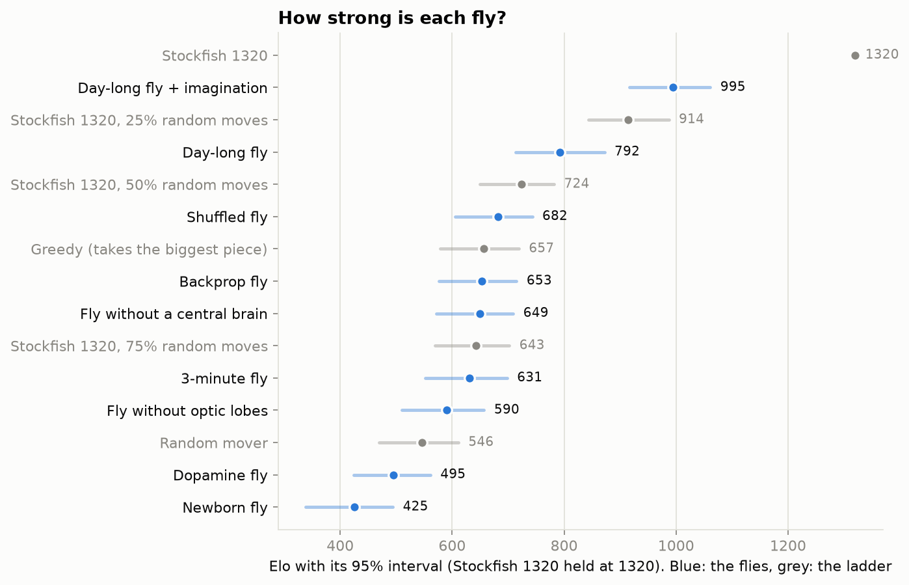

| Fly | Elo | 95% interval | random mover | greedy | SF 75% random | SF 50% random | SF 25% random | Stockfish 1320 |
|---|---|---|---|---|---|---|---|---|
| Day-long fly + [imagination](#making-it-stronger-without-cheating) (one move ahead) | **995** | 917 to 1061 | 20-0-0 | 12-8-0 | 20-0-0 | 16-2-2 | 13-1-6 | 0-0-20 |
| **Day-long fly** (26.2M positions) | **792** | 713 to 872 | 9-11-0 | 3-17-0 | 8-12-0 | 8-12-0 | 3-10-7 | 0-3-17 |
| Shuffled fly | 682 | 605 to 743 | 7-13-0 | 2-17-1 | 0-20-0 | 2-15-3 | 0-10-10 | 0-0-20 |
| Backprop fly | 653 | 576 to 715 | 2-18-0 | 0-19-1 | 2-17-1 | 1-16-3 | 0-9-11 | 0-0-20 |
| Fly without a central brain | 649 | 572 to 709 | 2-18-0 | 0-18-2 | 1-19-0 | 1-18-1 | 0-7-13 | 0-0-20 |
| 3-minute fly | 631 | 552 to 698 | 3-17-0 | 0-20-0 | 1-18-1 | 0-14-6 | 0-5-15 | 0-1-19 |
| Fly without optic lobes | 590 | 510 to 657 | 1-19-0 | 0-18-2 | 0-16-4 | 0-15-5 | 0-2-18 | 0-0-20 |
| Dopamine fly | 495 | 424 to 561 | 5-15-0 | 0-15-5 | 0-7-13 | 0-1-19 | 0-1-19 | 0-0-20 |
| Newborn fly | 425 | 338 to 494 | 1-15-4 | 0-14-6 | 0-4-16 | 0-0-20 | 0-0-20 | 0-0-20 |

*Won-drawn-lost against each rung, 20 games each. Every game is in [app/static/ratings.json](app/static/ratings.json).*

The backprop fly, the shuffled one and the one without a central brain land right next to the greedy mover and Stockfish playing three moves in four at random. The dopamine fly and the newborn land below a random mover. The order is the same as in [the controls](#measuring-strength) further down, measured a completely different way: the shuffled wiring on top again, the real brain and the one without its central part tied, the brain without its optic lobes behind them. Training helps a little: the backprop fly after 25 minutes is 22 points above the same fly after 3, well inside the noise. The day-long fly is the first to stand out: 139 points above the backprop fly, and 31 wins in 120 games where the backprop fly has 5; the two intervals barely touch (713 to 872 against 576 to 715). With imagination the same fly is 203 points higher again, and that interval doesn't overlap any other fly's: it won 16 of its 20 games against Stockfish playing half its moves at random, where no other fly won more than 8. The newborn's readout never learned anything, and it loses even to a random mover, which at least spreads its mistakes around.

Look at the draws, though. The backprop fly drew 18 of 20 against the random mover and 17 of 20 against Stockfish playing a quarter of its moves for real, and the seven older flies together drew 84% of their games against the random and the greedy mover (the day-long fly 70%, and 20% with imagination). They win material against anyone weak and then can't checkmate, and a draw is half a point however many queens you're up. So a fly's score barely depends on how strong its opponent is, while the Elo formula assumes it does. Read the numbers as "about as strong as", not as precise ratings. (Two flies have ever got anything off Stockfish 1320: the 3-minute fly one draw, the day-long fly three.)

Two more warnings. These are computer-list Elos at the very bottom of the scale, reached through an artificial ladder, so a 995 here is not a chess.com 995: this scale comes from engines playing engines, chess.com's from people playing people. And the intervals only count the luck of 20 games per pairing, not how badly one number fits a fly that draws everything.

`python -m flychess.rating --games 20` reruns it in about an hour on my laptop (the dopamine fly is the slow one, because it runs its whole brain once for every legal move), carries on where it stopped if you interrupt it, and writes the ratings the interface shows.

**The controls that make it science.** Showing the fly learns is a demo. Checking whether its *wiring* is the reason is the experiment. Same recipe every time (calibrate, then fit the readout on 50,000 positions), only the brain changes:

```bash
python -m flychess.train_dl --minutes 0 --shuffle-wiring --name probe-shuffled             # same statistics, wrong wiring
python -m flychess.train_dl --minutes 0 --lesion "optic lobe" --name probe-no-optic-lobe  # cut a region out
```

`--minutes 0` does only the calibration and the readout probe, about 3 minutes each.

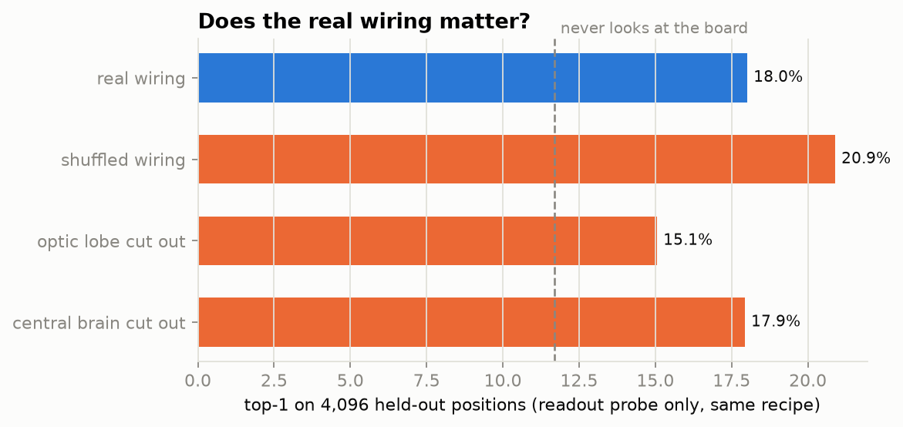

| Brain | Top-1 | Good moves | Held-out loss |
|---|---|---|---|
| real wiring | 18.0% | 26.6% | 3.040 |
| **shuffled wiring** | **20.9%** | **30.1%** | **2.951** |
| optic lobe cut out | 15.1% | 23.0% | 3.091 |
| central brain cut out | 17.9% | 26.3% | 3.042 |
| never looks at the board | 11.7% | 19.5% | |

*4,096 held-out positions, calibration and readout probe only, no training.*

The control I expected to lose, won. A brain with the same neurons, the same number of outputs per neuron and the same synapse strengths, only pointing at random targets, reads chess better than the real fly. I didn't find this control in the other fly-chess projects (Hakim's lists it as a next step), so I can't say if theirs would do the same.

I measured what I could to see why. In the shuffled brain every descending neuron gets input straight from a visual neuron, because visual neurons are more than half the brain and random targets keep landing on them. In the real brain only 51% do, the rest only hear about the board after the central brain has boiled it down. The board also moves the shuffled brain's descending neurons more: a spread of 0.274 against 0.240. A real fly's descending neurons listen to circuits that turn vision into "turn left" or "take off", and a chess readout wants nearly the opposite: where every single piece is. Random networks are known to make decent reservoirs (that's the whole idea behind echo state networks), and for reading chess this random one beats the one evolution built for flying. A 2025 study that turned the fly connectome into an echo state network found the same kind of thing for predicting a chaotic system: the real wiring overfits less, but random reservoirs matched or beat it in some settings.

Cutting regions out hurts less than I expected too. Without the optic lobe, more than half of all neurons, the fly still gets 15.1%: photoreceptors also have 2,949 connections straight onto visual projection neurons, and homeostasis turns whatever signal is left back up to full volume. Cutting out the central brain, where a real fly makes its decisions, changes nothing at all (17.9% against 18.0%). So the readout gets the board some other way, most likely from the half of the descending neurons that hear it straight from visual neurons, the same short route that makes the shuffled brain better.

So the honest headline is "a fly brain can carry a chessboard from its eyes to its legs", not "a fly brain is built for chess". The one thing that could change it is training the brain itself (cheat 5), and on a laptop that made things worse.

## Playing against it

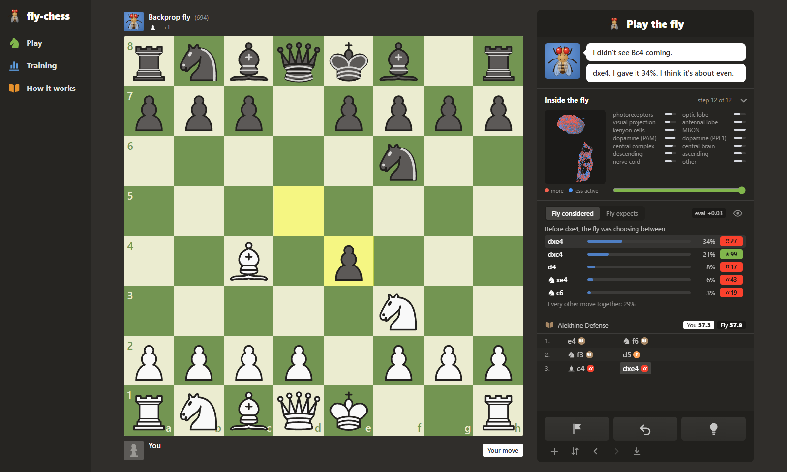
*Mid-game against the backprop fly. Top right, what it says about my move and its own. Under that, its brain after the think, the moves it was choosing between with Stockfish's grade on each, the opening, both accuracies and the moves so far. My Bc4 left the bishop hanging. The fly's favourite was dxe4 at 34%, which Stockfish calls a blunder, and it played it. Its second choice, dxc4 at 21%, takes the free bishop and is Stockfish's best move.*

It looks like chess.com on purpose. The first version was a white room I baked in Blender, with a wooden table, a marble board and a housefly that flew over and carried its pieces on real IK legs. It was fun to build and it looked great in screenshots, but playing in it felt like a 3D demo with a chess game somewhere inside, and the table was more realistic than a chess game needs. Seen from above, 3D pieces are hard to read too: an AI vision model named 62% of them right in screenshots of scrambled positions, against 100% for flat icons. So now it's the layout everybody already knows from playing bots online: green squares, flat pieces, a player bar above and below the board, and a panel on the right where the fly is the bot.

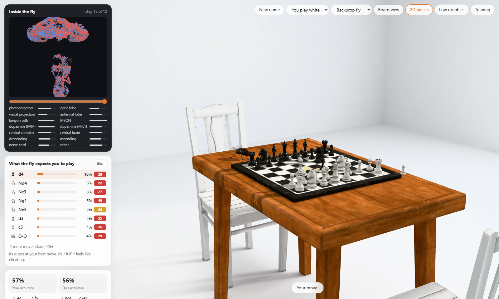

*The old room. The server, the brain and the Stockfish grades behind it didn't change.*

`uvicorn app.server:app` serves everything: FastAPI for the fly and Stockfish, plain JavaScript modules for the page, three.js only for the brain, no build step. Every chess rule lives in python-chess on the server. Each legal move it sends comes with the position it leads to, so the board only ever draws positions the server gave it, and between two positions it slides whatever moved. That makes a move, a takeback and stepping back through the game the same animation.

- **Pick a fly** the way you'd pick a bot on chess.com. There are eight, each with its Elo from [the rating ladder](#an-elo-after-all): three trained flies, which have the same brain and just learned differently (the backprop fly, the [day-long fly](#making-it-stronger-without-cheating) and [the dopamine fly](#the-biological-version)), and five lab flies, the control brains from the experiments above. The 3-minute fly is the backprop fly before most of its training, then the shuffled wiring, no optic lobes, no central brain, and a newborn that never trained at all. The fly's rating shows next to its name during the game, like a chess.com bot's. You stay anonymous.
- **Your move.** Click a piece then a square, or drag it. Squares you can go to get a dot, pieces you can take get a ring, and a promotion opens a column of pieces to choose from. Right-click marks a square and right-drag draws an arrow, like on chess.com.
- **Premoves.** While the fly thinks you can pick a piece up and put it where you'll want it. Its squares turn red, and it's played the moment the fly has moved, if it's still legal then (a pawn that reaches the end becomes a queen). Right-click calls it off.
- **The fly's move.** The server runs the brain once, the brain card replays the 12 steps from the eye to the legs (1.3 seconds), then the piece slides over and the fly says what it played and how sure it was: `dxe4. I gave it 34%. I think it's about even.` The last part comes from its value readout, the one that guesses how good the position is. If its favourite move would repeat a position, it says so and plays the next one. The browser sends the positions of the game so far, so it won't walk you into a repetition draw either.
- **What it was thinking.** Two tabs. *Fly considered* shows what it was choosing between, one move ahead, as probabilities, with its own eval of the position next to the tabs. Next to each move, Stockfish's accuracy for it (depth 12, Lichess's formula) and Lichess's verdict. *Fly expects* shows what it expects you to play, which is basically a hint, hence the blur button. Those moves only get Stockfish's grades once you've moved, because grading your options before you choose would be a free hint. Point at a move to see it as an arrow on the board.
- **The buttons.** Resign (it asks twice), takeback, and a hint, which is Stockfish's best move as a green arrow. Under those: new game, flip the board, back and forward through the game, and download it as PGN. The arrow keys step through the moves too, and F flips the board.

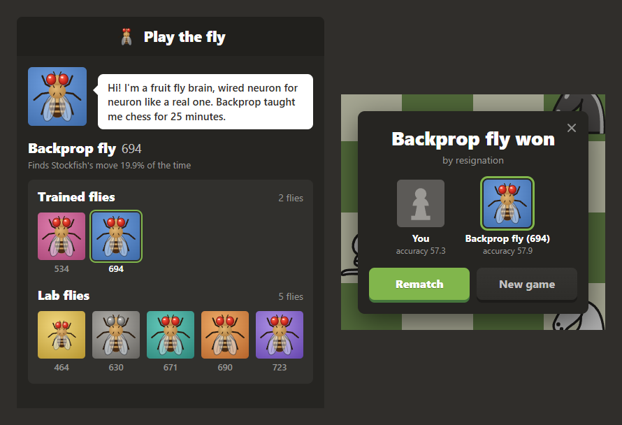

*Picking a fly before the game, and how it ends when you resign.*

**Opening names.** The line above the moves comes from Lichess's table of 3,865 named openings. My first version looked the position up, and after 1.e4 Nf6 2.Nf3 it told me I was playing the Zukertort Opening: Lemberger Gambit. The table isn't wrong: Lichess names every position once, and 1.Nf3 Nf6 2.e4 reaches the same one. chess.com names openings by move order, so now the name comes from the longest named line the game follows move by move (Alekhine Defense), and the position lookup only decides which moves get the little book icon.

**Draws.** A FEN has no history, so the server used to miss repetitions completely, and you could shuffle a knight back and forth forever. Now the browser sends the positions of the game so far, and the server calls a draw by repetition when a position really comes up for the third time. The 50-move rule waits for the 50th move too, where python-chess's `claim_draw` stops the game a move early, as soon as the player to move *could* claim it.

<p>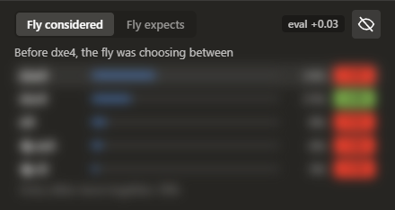 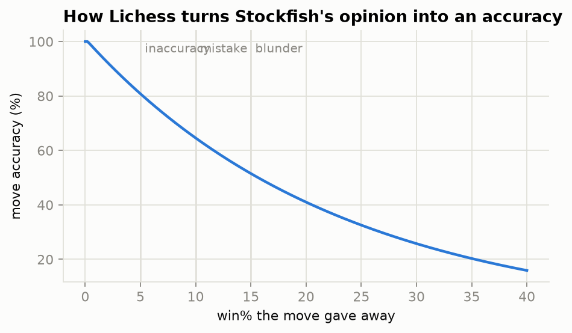</p>

The accuracy maths, straight from Lichess's source (lila):

```
win%     = 50 + 50 * (2 / (1 + exp(-0.00368208 * centipawns)) - 1)
accuracy = 103.1668 * exp(-0.04354 * (win% before - win% after)) - 3.1669 + 1
```

A move that gives away 5 win% gets `103.17 * exp(-0.218) - 2.17 = 80.8%`. Giving away 5, 10 or 15 win% is what Lichess calls an inaccuracy, a mistake and a blunder.

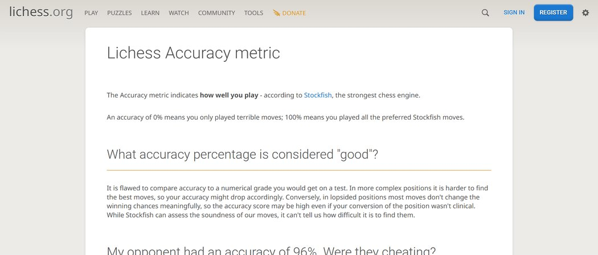

*Lichess's own page about it, which also warns that accuracy isn't a school grade: in a complicated position even good players score lower.*

**It shouldn't lag.** The fly thinks on the GPU in the server, never in the browser. The board is plain HTML, 32 pieces moved by CSS transforms, so the browser slides them on its own. The only WebGL left is the brain card: all 12 steps of all 139,593 neurons go to the GPU once per think and the shader picks the step, so replaying costs nothing, and drawing it takes 0.2 to 0.5 ms on my laptop's integrated Radeon 780M. (Measured by drawing it 200 times back to back and waiting for the GPU to finish.) In real play I timed every frame from my click on e4 until the fly's knight had landed on f6: 2.2 to 2.3 seconds, 1.3 of them the brain replay on purpose. The middle frame took 7 ms, which is the screen's 144 Hz, and the slowest single one 14 ms, so at worst one frame late. The first version had one 55 ms frame per move, and two fixes made it go away: copying the think into the brain went through a shuffle left over from the old low-graphics mode (17 ms, now 12), and the region bars were rebuilt on every frame of the replay, 185 times a move instead of 12.

**Training** (in the left bar) draws every run in `runs/` and refreshes every 10 seconds, so you can watch a fly learn in the browser while it trains. Hover for the numbers.

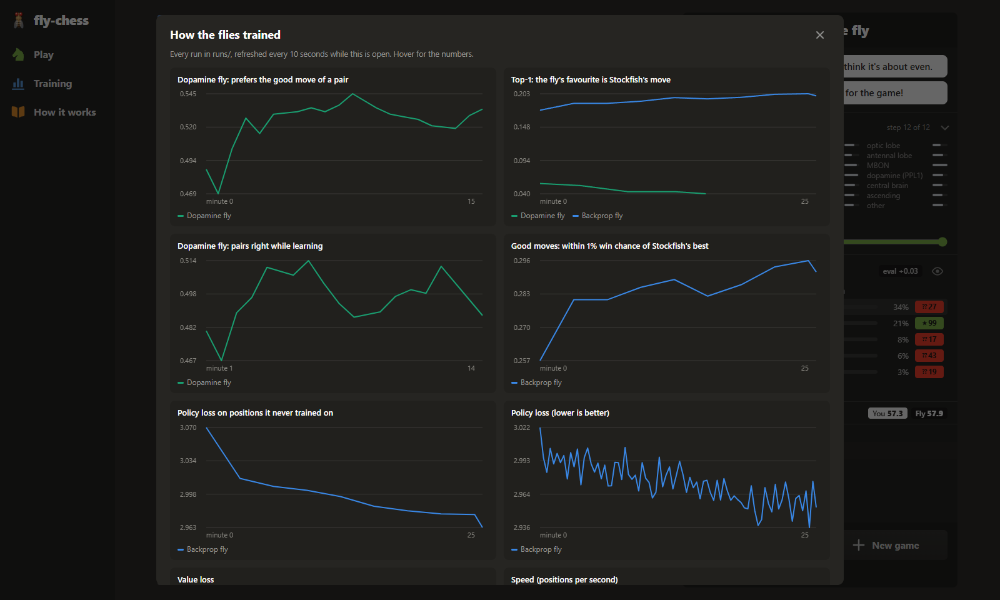

## Fly brains are everywhere right now

The MaleCNS paper came out on 3 September 2026, and the next day a grad student had the fly brain playing Minecraft. Then Doom, Beat Saber, bitcoin trading and, yes, chess.

<p>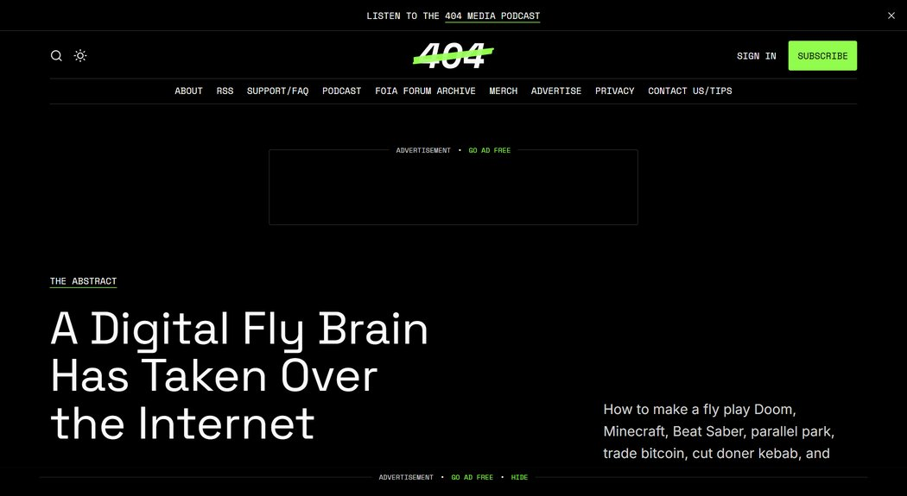 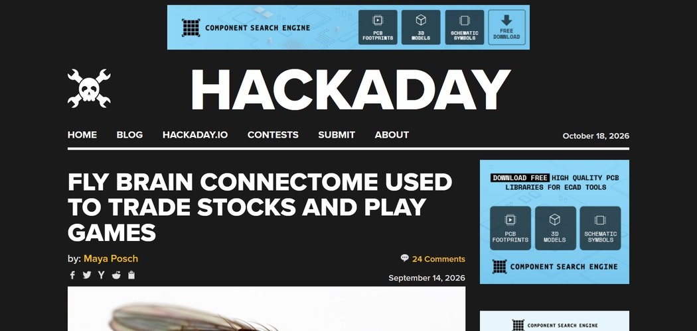</p>

*404 Media, [A Digital Fly Brain Has Taken Over the Internet](https://404media.co/a-digital-fly-brain-has-taken-over-the-internet), and Hackaday, [Fly Brain Connectome Used To Trade Stocks And Play Games](https://hackaday.com/2026/09/14/fly-brain-connectome-used-to-trade-stocks-and-play-games/).*

<p>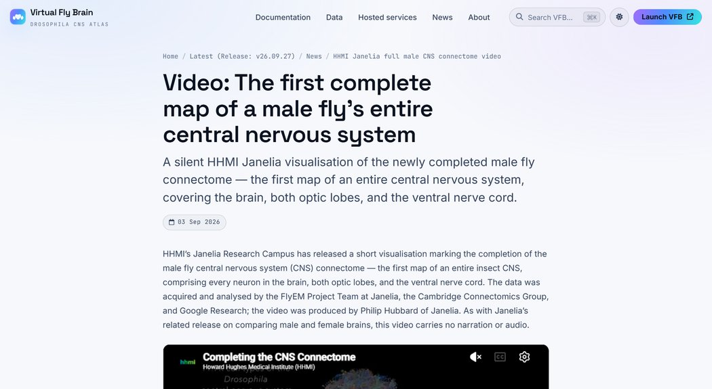 </p>

Other people taught a fly brain chess too, and I read all of them before going further:

| Project | Brain | Result | What I took from it |
|---|---|---|---|
| [HakimElAyoubi/fly-chess](https://github.com/HakimElAyoubi/fly-chess) | MaleCNS, brain side, 24 ticks | 26.4% top-1 on human moves, 168 minutes on 4x RTX 5090 | scaling the descending neurons, an anti-repetition rule |
| [cesp99/fly-chess](https://huggingface.co/cesp99/fly-chess) | FlyWire, 16 steps | 37% top-1 on human moves, 17 hours on an RTX 5080 | per-neuron gains so the signal survives |
| [mlabonne/chessfly](https://huggingface.co/mlabonne/chessfly) | FlyWire, 5 steps | 30.4% Stockfish top-1 | per-step normalisation, the idea behind my homeostasis |
| [Aananda-giri/fly-chess](https://huggingface.co/Aananda-giri/fly-chess) | MaleCNS frozen + a 2.4 M cortex | 79% against Stockfish 1320 | mostly alpha-beta search doing the work |

<p>  </p>

None of their weights fit this model (different connectomes, synapse cutoffs and dynamics), and as teachers they'd all be weaker than Stockfish, which is already the teacher here.

## Making it stronger without cheating

Everything here has to pass the test from [the top](#fly-chess): could a fly brain plausibly do it? So no search, no handcrafted evaluation, no Stockfish at play time, no hidden layers in the readout (they'd do the thinking instead of the fly), and the wiring and the signs stay as measured. Inside those rules, this is what I expect to pay most, what I tried, and what I haven't tried yet. Stockfish stays the teacher only.

**1. Let it see the whole board.** The first eye was blind on 12 squares ([the eye](#the-board-goes-in-through-the-eye)). The fair eye isn't more or less of a fly, it's a fairer way to hold a chessboard in front of one. Same recipe, the 3-minute readout probe on the same rows: top-1 17.7% with the first eye, 18.8% with the fair one, held-out loss 3.026 against 3.015. That loss difference is about as big as the noise between two probes, so I wouldn't sell it as more than "not worse, and no blind corners".

**2. Teach it to finish games.** The draws come from a teacher that calls every winning move 100% ([why it can't finish](#why-it-cant-finish)). [scripts/make_curriculum.py](scripts/make_curriculum.py) has Stockfish rank the moves of won positions again, by centipawns and by how many moves the mate takes: 111,911 decided positions from the downloaded ChessBench files and 11,100 random basic endgames that Stockfish calls won (queen, rook, two rooks, two bishops, queen against a minor piece, pawns to promote), 6,365 of them kept back to test on. `--curriculum 0.1` puts a tenth of every batch from there and leaves out the old copies with their flat 100% labels. Still the same fly with better lessons, the way a fly in a lab gets trained in stages.

**3. More lessons.** The 25-minute run saw 17% of the downloaded positions, and its held-out loss fell at every check. Nothing about the fly changes, it's the cheapest thing on the list, and [the learning curve](#9-a-day-on-a-laptop-measured-first) says it keeps paying: about 0.026 off the held-out loss for every doubling of the positions, 22.2% top-1 from 500,000.

**4. Read the descending neurons over time.** Motor circuits don't act on one instant, they add a command up over time. So instead of only step 12, the readout can read the mean of steps 9 to 12: the same 1,314 numbers in, no extra work for the brain (it goes through those steps anyway). Fitted on the same 300,000 positions, that gives a held-out loss of 2.906 against 2.918 and top-1 21.7% against 21.2%. Reading all four steps side by side, with their own weights each (four times the numbers), does worse, 2.932: the bigger readout learns the training positions instead of chess. The mean is small, free, and the day-long fly uses it (`--read 9 10 11 12`).

**5. Let the brain learn, on a leash.** [Watching the error go back](#watching-the-error-go-back) found why this failed before: neurons the board hasn't reached yet get the biggest gain homeostasis has. `--calm-unreached` gives them gain 1 instead, which changes nothing for the brain as measured (tested in [tests/test_training_flag.py](tests/test_training_flag.py)). On top of that, `--brain-opt sgd` moves every synapse by its own gradient instead of Adam's same-sized step for all 6.2 million, and `--max-change 0.2` keeps every synapse within 20% of its measured strength. Real neurons tune their own excitability (intrinsic plasticity, Desai, Rutherford and Turrigiano 1999) and their synapses, but nothing in a fly rewires its brain from scratch. The signs and the wiring stay fixed, as always.

**6. Habituation against repetition.** Real neurons stop answering a stimulus they keep seeing, and one mushroom body output neuron, MBON-α'3, signals novelty and habituates to familiar odours (Hattori et al. 2017). A fading memory of this game's positions with a penalty for going back to one would fight the repetition draws. The dopamine fly already smells the position after each of its moves, so it slots in there; the backprop fly would have to look at its own afterstates first, which is the grey zone below. Not built yet.

**7. Two glances.** The first look picks the piece, that square gets attention (more drive into its patch of the eye), and the brain runs again to pick where it goes. The central complex keeps a heading and steers towards a goal (Seelig and Jayaraman 2015, Green et al. 2019), which is about the closest a fly comes to "look here, then there". Twice the compute per move. Not built yet.

**8. The dopamine fly.** I tried five changes from the same untrained mushroom body, 32,000 lessons each, scored on 512 held-out pairs ([tools/bio_pilots.py](tools/bio_pilots.py)):

| Pilot | Pairs right, before → after | Harder pairs (2nd best move) | Top-1 |
|---|---|---|---|
| what bio.py does (5% of Kenyon cells) | 49.2% → 49.6% | 52.8% | 6.5% |
| 2% of Kenyon cells | 50.0% → 51.6% | 54.4% | 7.5% |
| 3% | 47.6% → 50.2% | 52.8% | 6.0% |
| 10% | 47.6% → 51.6% | 53.5% | 6.0% |
| silent cells' synapses get stronger too (Berry et al. 2018) | 47.5% → 46.1% | 52.3% | 4.0% |
| harder lessons after 16,000 | 48.8% → 49.6% | 53.2% | 6.0% |
| the dose from its own dopamine neurons, MBON feedback included (Felsenberg et al. 2017) | 46.5% → 53.3% | 52.7% | 7.0% |

With 512 pairs, two runs of the same thing differ by about 3 points, so none of these is a result, except maybe that strengthening silent synapses makes it worse. The [lesson comic](#how-this-fly-learns-chess) says where the real limit is: 188 of the roughly 200 Kenyon cells fire for both positions of a lesson. No dopamine rule can tell apart what the Kenyon cells don't. The biological fix would be better pattern separation before the Kenyon cells, and that's the next thing to try for this fly.

**The long run.** The day-long fly got items 1 to 4 at once: the fair eye, the curriculum, the mean of steps 9 to 12, and a readout fitted on the brain's activity for all 3.09 million downloaded positions, then for as many more as the day left time for ([scripts/train_day.sh](scripts/train_day.sh)), and then more positions in 8-hour cycles that each end with a fit and its Elo, until I stopped it ([scripts/train_more.sh](scripts/train_more.sh)). The whole run, what stalled and what I'd do differently, is in [two days on a laptop](#two-days-on-a-laptop-what-worked-and-what-didnt). Fitted on the first 3.09 million alone it already picks Stockfish's move in **23.0%** of the held-out positions (the 25-minute fly: 19.9%), with a held-out loss of 2.868 (2.963), and in won positions it finds the fastest win 13.2% of the time, against 8.0% for the same recipe without the curriculum. With 7 more ChessBench files, 6.58 million positions in all, it got to **23.1%** and 2.853, and an Elo of 788 (716 to 853) at the time.

After the first 8-hour cycle, on 17.4 million positions, it was at 22.9% and 2.853 again, and 752 (677 to 821) in a fresh round of games: two and a half times the data had bought nothing I could measure. That was mostly the fit. Its first pass over the new files helped, and the next four only bounced around it, because a step size that suits a readout starting from scratch is too big for one that's nearly fitted. Now a pass that doesn't help goes back to the best readout and halves the step, and the readout it starts from has to be beaten before anything gets saved. After the second cycle, on 26.2 million positions, that fit took 16 passes and got to **23.5%**, 34.3% good moves and 2.840, and **792** (713 to 872) in games. So more data still helps, but slowly: about 0.01 of loss for every doubling, and every doubling takes twice as long as the last. That's where I stopped adding data. The readout is a single layer over the 1,314 descending neurons, on purpose, and it's getting close to what that can learn. Every cycle's numbers are in `runs/dl-day/elo.jsonl`.

Item 2 half worked. At 6.58 million positions the day-long fly won 30 of its 120 rated games, every one by checkmate, where the backprop fly won 5. But when it doesn't mate, it now stalemates. Against the random mover it went 7-13-0 (the backprop fly 2-18-0), and 11 of those 13 draws were stalemates with the fly a rook or more up; the backprop fly drew half of its 18 by repeating moves and stalemated 3. Over all its games, 33 of its 58 draws were stalemates, every one a rook or more up. Seeing a stalemate coming is the next thing the curriculum has to teach: those lessons are made (`make_curriculum.py --stalemates`, 18,985 of them), but the fly hasn't trained on them yet.

**Keeping it cool without stopping.** The heat guard used to pause everything when the CPU reached 93°C and let it go again at 84. On this laptop that happened every two minutes: 90 seconds flat out, then 40 to 60 seconds of nothing, and a file went through the brain at 265 positions a second instead of 387. Now the guard is a throttle. The training runs a share of every second and is paused for the rest, and every 20 seconds the share goes down when the GPU is over 75°C or the CPU over 85°C, and back up when both are well under ([tools/heat_guard.py](tools/heat_guard.py)). To find the right share I held it at 85, 75, 65 and 55% for 8 minutes each, and the CPU stayed at 89 to 91°C at every one of them. That wasn't the training: an NVIDIA App telemetry process had been spinning a whole CPU core since the evening before, 1,293 minutes of CPU time. With that one stopped, the throttle settled at about 80%. The CPU stays at 85°C, the GPU at 65°C, nothing pauses, and the brain goes over 318 positions a second, 20% more than flat out with pauses.

Two things went wrong on the way, and the laptop sat idle for 9 hours because of them. The download of the 8th extra file broke halfway ("Connection broken: IncompleteRead"), and my code stopped adding files at the first failed download, 14 hours early. Then, in the Elo games, the heat guard paused everything for 40 seconds to cool down. python-chess waits 10 seconds for Stockfish's move, so when the games carried on, that move timed out and the rating crashed. The crashed process couldn't even exit, because python-chess's engine thread waits for Stockfish to quit and nobody told it to. Now a broken download gets five more tries, 30 seconds to 8 minutes apart; a Stockfish that was paused too long gets replaced by a fresh one (I tested it by pausing one for 15 seconds mid-game); every engine gets closed even when a game crashes; and [tools/watch.py](tools/watch.py) warns when the log has been quiet for 45 minutes. It had shown "Elo games" for all 9 hours without a hint.

Item 5 ran as three 15-minute pilots in the middle of it, from the same readout probe, and failed again: the readout alone got to 19.7% top-1 (held-out loss 2.949), with the neurons' gain and bias learning too 15.8% (3.038), and with the synapses learning as well 15.8% (3.036). It's the same shape as in cheat 5. On the VAL positions the readout alone went steadily from 3.024 down to 2.966, while both brain pilots jumped up to about 3.08 in their first 250 steps and then crawled back, to 3.04 after 15 minutes, still worse than where they started. Even the gain and bias alone, with SGD and a gradient of only 0.17, were enough to do that. Calm homeostasis took away the gain of the neurons the board hasn't reached; the ones it has reached can still have a gain of 25, and that's my next suspect.

**The grey zone: imagination.** The day-long fly stalemates because it can't see the position after its move: it scores a move as "the square it moves from" plus "the square it moves to", read straight off the board, and "this one queen move takes the king's last square" is a fact about one move in one position. So I built imagination, as a switch. Before it moves, the fly looks at the board after each of its own legal moves, one move ahead and never at the replies ([flychess/play.py](flychess/play.py), `look_ahead`):

- a move that checkmates gets played;
- a move that ends the game in a draw by the rules (stalemate, too little material, the third repetition, 50 moves) is worth exactly a draw, and it's out whenever another move leaves the fly better off;
- every other move scores `log(p) + w x v`: p from its move readout, v from its own value readout looking at the board after the move.

How much to trust the value readout, w, is tuned on the 4,096 held-out positions after every training cycle ([tools/imagine_lab.py](tools/imagine_lab.py)), by which w picks a move within 1 win% of Stockfish's best most often. It costs about 30 brain passes a move, 0.1 seconds. Looking two or three moves ahead would mean the opponent's replies too, a search tree, about 900 and 27,000 brain passes a move, and that's exactly what this project leaves out: with a search most of the strength would come from the search, not the brain. The dopamine fly already plays one move ahead by design. In the app it's the Imagination switch, and the day-long fly gets rated with and without it after every cycle, in `runs/dl-day/elo.jsonl`. The fly without imagination stays the main result.

The first numbers, after the first cycle (17.4 million positions). On the held-out positions the value readout alone is a poor judge of moves, so the tuning settled on a light touch:

| w | Top-1 | Good moves |
|---|---|---|
| 0 (move readout, plus the mate and draw rules) | 23.2% | 33.5% |
| **1** | **23.7%** | **34.0%** |
| 4 | 22.2% | 31.1% |
| value readout alone | 11.7% | 18.0% |

In games it's another fly. With imagination it rates **934** (859 to 1001), without it **752** (677 to 821), the same readout both times. It beat the random mover 19 times in 20, won 65 of its 120 games against 22, and never stalemated once, where without imagination it stalemated 39 times. The draws that were left were mostly repetitions, 21 of them, more than without imagination (11): it only refused the move that made a position come back for the third time, and the opponent's reply could do that too. So now it also refuses to go back to an earlier position while it's ahead, the way the fly without imagination always did. After the second cycle, with that rule and the better readout (and w = 0.25 this time), it rated **995** (917 to 1061) against 792 without: 81 wins in 120, 4 repetition draws instead of 21, never a stalemate, and only 2 draws with a rook or more up. It still lost all 20 games against Stockfish 1320 itself.

## Two days on a laptop: what worked and what didn't

I trained the day-long fly for about 40 hours, from 02:30 on a Tuesday to 19:00 on the Wednesday, on one laptop with one GPU, and then stopped it myself. On the way it stalled twice, once because the machine stopped and once because the fit did, and I changed my mind about how to train it more than once. This is the whole run in order, what each step was worth, and what I'd do differently.


*Every fit of the long run, measured on the same 4,096 held-out positions, after the 25-minute backprop fly. Most of the gain came from the new recipe in the first three and a half hours. Two and a half times the data then bought nothing, until the fit itself got fixed.*

| Stage | When | Positions | Top-1 | Good moves | Held-out loss | Fastest win | Elo |
|---|---|---|---|---|---|---|---|
| Backprop fly, 25 minutes | before | 0.5M | 19.9% | 29.2% | 2.963 | | 653 |
| New recipe, first fit | Tue 05:57 | 3.0M | 23.0% | 33.1% | 2.868 | 13.2% | |
| 7 more ChessBench files | Tue 11:15 | 6.6M | 23.1% | 33.7% | 2.853 | 13.2% | 788 |
| Cycle 1, the old fit | Wed 06:51 | 17.4M | 22.9% | 33.3% | 2.853 | 14.2% | 752 |
| **Cycle 2, the fixed fit** | Wed 18:29 | **26.2M** | **23.5%** | **34.3%** | **2.840** | **14.4%** | **792** |
| the same fly + imagination | Wed 18:53 | 26.2M | | | | | **995** |

*Top-1: Stockfish's own move. Good move: within 1 win% of Stockfish's best. Fastest win: how often it picks the quickest win in the curriculum's held-out won positions. Every round of Elo games refits everybody together, so the ladder moves by 10 to 30 points from round to round. In the last round the backprop fly is at 653, the day-long fly at 792 and with imagination at 995.*

### Where it stalled

**The first day mostly stalled.** On the first night the readout fit tried to put all 4 GB of brain activity on the GPU at once: one crash at 04:46, and a second at 04:54 that took the whole WSL machine down with it. Streaming it in 344 MB blocks fixed that ([cheat 9](#9-a-day-on-a-laptop-measured-first)). At 11:11 a download broke halfway and my code stopped adding data 14 hours early, and at 11:18 the Elo games crashed on a heat-guard pause and then couldn't exit, so the laptop sat idle for 9 hours until I looked. Of the 18 hours the first day was meant to spend adding data, it got 4. Later, on the Wednesday at 15:02, the Windows helper that reports the CPU's temperature died over a file it was replacing while WSL was reading it. By then a watcher was checking the run every 30 minutes and on every warning, and it caught that one within 4 minutes.

**The learning, once.** Cycle 1 went from 6.6 to 17.4 million positions, two and a half times the data, and top-1 went from 23.1% to 22.9%. I first blamed the readout, one layer over 1,314 neurons can only learn so much, and almost stopped there. The log said otherwise. The fit's first pass over the new files helped (VAL loss 2.8584), and the next four only bounced around it (2.8648, 2.8650, 2.8605, 2.8594) until the early stop gave up. The step size suits a readout starting from scratch and is too big for one that's nearly fitted. So now a pass that doesn't help goes back to the best readout and halves the step, and the readout it started from has to be beaten before anything gets saved. Cycle 2 went on to 26.2 million positions with that fit. It took 16 passes and halved the step 7 times, and got from the stalled 22.9% to **23.5%** top-1 (+0.6 points), from 33.3% to **34.3%** good moves (+1.0), from 2.853 to **2.840**, and from 752 to **792** Elo.

### Overheating, and the safeguards I built

A laptop isn't built to run flat out for two days. Eight Stockfish workers next to the GPU job took the CPU to **98.9°C**, a degree from the Ryzen's limit, so before and during the run I built safeguards, all in the repo:

- **A heat guard** ([tools/heat_guard.py](tools/heat_guard.py)). At first it paused everything at 93°C and let it go at 84. That was stop-and-go every two minutes and cost a third of the time. Then it became a **throttle**: the training runs a share of every second, and the share moves every 20 seconds to hold the CPU near 85°C and the GPU near 75°C. 318 positions a second instead of 265, and nothing pauses. The full pause stays as an emergency brake.
- **A Windows helper** ([tools/windows_helper.py](tools/windows_helper.py)). WSL can't read the laptop's temperature sensors or stop Windows from sleeping, so a small program on the Windows side does both. It died once over a file race; now it retries and logs.
- **A memory guard**, which stops the biggest job before WSL runs out of memory (running out took the whole WSL machine down once), and **timeouts and retries** that survive the heat guard's pauses.
- **A watcher** on the logs and the temperatures, every 30 minutes and on every warning, which restarts what died.

Not all of the heat was mine: an NVIDIA App process had been spinning a whole CPU core for a day. With it stopped, the CPU went from about 90°C to the low 80s at the same load. Every temperature reading of the run is in [results/heat](results/heat).

### What worked

- **The recipe, in the first three and a half hours.** The fair eye, the finishing lessons, reading the mean of steps 9 to 12, and running the brain once per position and fitting the readout to the end: 19.9% to 23.0% top-1, 2.963 to 2.868 loss. That's most of what the two days bought.
- **Finishing lessons.** In won positions the fly finds the fastest win 13.2% of the time with them and 8.0% without, and 14.4% after the long run.
- **Imagination.** Looking at the board after each of its own moves, one move and no further: 792 to **995** Elo, 81 wins in 120 games instead of 31, and not one stalemate, where the plain fly had 42. It costs 0.1 seconds a move.
- **Fitting until it really stops.** The halving step turned a stalled cycle into the best fit of the run.
- **A throttle instead of a pause.** 318 positions a second instead of 265, at a steady 85°C instead of swinging between 80 and 95, once I'd found the NVIDIA process that was heating the CPU.
- **Letting it look after itself.** Retries, timeouts, a watcher on the logs and the temperatures, and the cache on the second SSD.

### What didn't

- **More data on its own.** From 3.0 to 26.2 million positions, almost nine times as many, bought +0.5 points of top-1 and 0.028 of loss. That's about 0.01 of loss for every doubling, and every doubling takes twice as long as the last, so I stopped at 26.2 million.
- **Letting the brain learn.** Three 15-minute pilots from the same start: the readout alone got to 19.7%, with the neurons' gain and bias learning too 15.8%, with the synapses learning as well 15.8%. Every version with the brain learning got worse.
- **The value readout as a judge.** On its own it picks Stockfish's move 11.7% of the time, half as often as the move readout (23.2%), so imagination only gives it a light weight (0.25 to 1). What imagination really adds is the rules: a mate gets played, a stalemate doesn't.
- **Repetitions, at first.** The first imagination games drew 21 of 120 by repetition, more than without it. It only refused the move that made a position come back the third time, and the opponent's reply could do that too. Refusing to go back to an earlier position while ahead brought it down to 4.
- **Stop-and-go cooling.** Pausing everything at 93°C cost about a third of the time.
- **The dopamine fly's pilots.** Five changes to its learning rule, none beyond the noise of 512 test pairs.

### Why I didn't use the most efficient methods

The most efficient way to make a chess player is well known: a search and a deep network. I left both out on purpose, because they'd be the ones playing chess, not the fly, and the whole point is the fly's own wiring. Every choice below costs strength, knowingly.

- **No search, ever.** The question is whether a fly brain can learn chess, not whether a search can. So the fly sees the board once and its neurons answer.
- **A readout with no hidden layers.** A deeper readout would learn chess by itself and leave the brain as a fancy input layer. With one layer, whatever the fly knows has to come out of its own neurons.
- **Imagination as a switch, and one move only.** Looking at the board after its own move is something a fly might plausibly do. Looking at the replies too would be a search tree, about 900 brain passes a move for two moves and 27,000 for three, and the Elo would then measure the search. So it's off by default, rated on its own, and the fly without it stays the main result.
- **A frozen brain and a cached readout.** With the brain frozen, each position only has to go through it once, and the readout can train on the cached activity for as many passes as it needs. Letting the brain learn made it worse anyway.
- **Stopping at 26.2 million positions.** Past that, a day of training buys a few tenths of a point.

### What could have made it more accurate

These I didn't get to, or started and stopped:

- **Reading steps 9 to 12 side by side.** The readout sees the mean of the four steps and throws away how the output moves from one step to the next. On 300,000 positions the four side by side did worse (2.932 against 2.906), but that was four times the weights on too few positions. I started a test on 3 million and stopped it at 8.5% ([tools/steps_lab.py](tools/steps_lab.py) picks up where it stopped).
- **Stalemate lessons for the fly without imagination.** 18,985 won endgames against a bare king where one careless move stalemates, labelled by Stockfish, are made and in `data/curriculum`, but the fly hasn't trained on them. It stalemated 42 of 120 games without them.
- **Two glances.** Looking at the board twice, first for the piece and then for the square, instead of scoring every move as "from square plus to square" in one go.
- **A brain that learns, carefully.** All three pilots got worse, but they were 15 minutes each, from one start, with one leash. Smaller steps on the gains alone might still help.
- **Better pattern separation for the dopamine fly.** Its Kenyon cells fire almost the same for two positions one move apart, and no learning rule can tell apart what they don't.

### What I'd do differently

1. **Check the fit before buying data.** Cycle 1's day bought nothing because the fit stopped too early. The halving step from the start would have saved it.
2. **Make every long job survive a pause and a crash.** A 10-second timeout and one missing `finally` cost 9 hours. Retries, timeouts that know about the heat guard, and processes that always exit are cheap to write before and expensive to find out about after.
3. **Look at what else heats the laptop.** I throttled the training for a while before finding an NVIDIA App process that had been burning a whole CPU core for a day.
4. **Think about what the fly can represent before training it longer.** A move scores "from square plus to square", so "this one queen move stalemates" was always going to be hard to learn, from any amount of data. One evening of imagination fixed what two days of data couldn't.
5. **Watch from the first hour.** The log watcher, the warnings and the heat readings came after the first 9-hour hang. They should have been there before it.

## Limitations

- It's weak at actual chess. One move in four or five is Stockfish's, without imagination it finishes too few won games (the day-long fly stalemated 42 times in 120 games, with imagination never), and no fly has beaten Stockfish's weakest setting: 4 draws in 180 games. There's no search, [on purpose](#fly-chess): it only ever looks one move ahead.
- The Elo ratings come from an artificial ladder anchored at Stockfish 1320, 20 games per pairing, so they're about ±70 points, on a computer scale rather than chess.com's, and the flies' all-draw games fit the Elo model loosely.
- The shuffled brain reads chess better than the real one (see [the controls](#measuring-strength)), so nothing here shows the fly's wiring is good for chess, only that it can carry a board to the legs.
- The readout (1,314 x 134 numbers) and homeostasis (a gain and bias per neuron, plus the calibration constants) are not the fly. Everything between the eye and the descending neurons is.
- Rates, not spikes. A rate model with a leak and `relu(tanh(...))` is a big simplification of real neurons, and treating dopamine, serotonin and octopamine as weak excitation is a guess.
- The eye mapping is mine: a fly's eye was never built to read an 8 by 8 grid. My first one was blind on 12 squares, and every fly in the tables above learned with it; only the day-long fly has [the fair eye](#the-board-goes-in-through-the-eye).
- ChessBench calls every winning move 100%, so the flies above never learned to prefer a mate. The curriculum fixes the labels for won positions, not the way the fly plays them out.
- The fly's chat lines are written by me. The numbers in them, its probabilities and its own rating of the position, are the fly's.
- Every number here comes from my laptop, often from a single run. The trends are clear; the exact percentages would move a bit with another seed.
- The Stockfish accuracy in the interface uses depth 12, so it's quick but not gospel.

## Project layout

```
fly-chess/
  scripts/
    setup_wsl.sh               WSL2: Python 3.12, TensorFlow with CUDA, Stockfish
    download_connectome.py     the three MaleCNS tables
    download_chessbench.py     positions with Stockfish's win% for every move (default)
    download_lichess.py        the Lichess eval database (the old source)
    download_openings.py       Lichess's opening names, for the interface
    make_curriculum.py         won positions, ranked again by Stockfish by how fast they win
    train_day.sh               a day of training, then the Elo and the pictures; safe to stop and rerun
    train_more.sh              after it, more positions for the same fly until you stop it
  flychess/
    connectome.py              tables -> neurons, signed connections, regions, eye positions
    io_maps.py                 board -> photoreceptors, descending neurons -> moves
    encode.py                  boards and moves <-> numbers, softmax over legal moves
    model.py                   the brain with homeostasis, the hand-written backprop
    train_dl.py                backprop training, with every cheat
    train_cached.py            the same with the brain frozen, the fast way: the brain once per position
    bio.py                     mushroom body, dopamine, the three-factor rule
    train_bio.py               tutor lessons or games
    play.py                    every fly, one-move imagination, plus random, greedy and Stockfish opponents
    evaluate.py                matches against fixed opponents, controls
    rating.py                  the Elo ladder anchored at Stockfish 1320
  app/
    server.py                  FastAPI: the fly, Stockfish, legal moves, openings, brain activity
    openings.tsv               3,865 named openings (Lichess, CC0)
    static/                    the board, the panel and the brain viewer (plain JS, three.js for the brain)
    static/ratings.json        every rated game and every fly's Elo, from rating.py
  tools/
    bio_rules.py               the dopamine rule experiment
    bio_pilots.py              five more changes to the dopamine fly, side by side
    readme_figures.py          the charts in this README
    brain_grid.py              the 12 steps (and the error going back) as a grid of brain pictures
    bptt.py                    d loss / d input for every neuron at every step, for one position
    descent.py                 gradient descent you can see: one position learning, the loss landscape
    bench.py                   where a training step's time goes
    readout_lab.py             readouts on cached brain activity: how much data, which steps
    steps_lab.py               steps 9 to 12 side by side against their mean, on millions of positions (not finished)
    imagine_lab.py             tunes how much imagination trusts the value readout
    confusion.py               which piece the fly moves against which piece Stockfish moves
    heat_guard.py              throttles everything heavy to hold a steady temperature, pauses it if that's not enough
    watch.py                   the long run live in the console, as bars
    windows_helper.py          keeps Windows awake and tells WSL the temperature
    three-entry.js             which part of three.js gets bundled
  notebooks/train_on_kaggle.ipynb
  tests/
    test_gradient.py           the hand-written backprop against TensorFlow's own
    test_training_flag.py      training reaches the brain, calm homeostasis and reading several steps
    test_mirrored.py           two GPUs (MirroredStrategy) give the same gradient as one
    test_repetition.py         the fly won't walk into a repetition
    test_server.py             draws only once they happen, openings named by move order, the Imagination switch
    test_imagination.py        mate in one, no stalemate while winning, no going back, draws counted right
    test_download_retry.py     a broken download gets tried again
  results/                     the long run's history: metrics, Elo per cycle, logs, temperatures (results/README.md)
```

Data, runs and checkpoints stay out of git (`data/`, `runs/`, `checkpoints/`); the small files from `runs/` are copied into `results/`, and the trained day-long fly is on the [releases page](https://github.com/S1MS4/fly-chess/releases).

## Credits and references

- **Connectome:** MaleCNS v1.0, FlyEM at HHMI Janelia Research Campus with Google Research and the Cambridge Connectomics Group, CC BY 4.0, [male-cns.janelia.org](https://male-cns.janelia.org/).
- **Training data:** ChessBench, Ruoss et al. 2024, *Amortized Planning with Large-Scale Transformers: A Case Study on Chess* (CC BY 4.0), via [prdev/chessbench-full-policy-value](https://huggingface.co/datasets/prdev/chessbench-full-policy-value). Lichess evaluation database, CC0.
- **Pieces:** Colin M.L. Burnett ("Cburnett"), from [Wikimedia Commons](https://commons.wikimedia.org/wiki/Category:SVG_chess_pieces), used under the 3-clause BSD licence he offers them with (also GFDL, CC BY-SA 3.0 and GPL); see `app/static/pieces/LICENSE.txt`. Recoloured to chess.com's greys, the shapes are his. Lichess ships the same set. I picked it over the newer Lichess sets because most of those are licensed for non-commercial use only.
- **Opening names:** [lichess-org/chess-openings](https://github.com/lichess-org/chess-openings), CC0.
- **The fly avatar** is an SVG drawn for this project (`app/static/img/fly.svg`), so it's MIT like the code.
- **The old room's picture:** "Housefly" by schmoldt.art ([Sketchfab](https://sketchfab.com/3d-models/housefly-5fe7cbd25f9a446d8bae005893d010dd)), CC BY 4.0, skeleton added and wing material changed. "Chess Set" by Riley Queen, "Wooden Table 02" by Serhii Khromov and "Painted Wooden Chair 01" by Kuutti Siitonen, all CC0 from [Poly Haven](https://polyhaven.com).
- **Figures:** Dorkenwald et al., *Neuronal wiring diagram of an adult brain*, Nature 2024 (CC BY 4.0). Aso et al., *The neuronal architecture of the mushroom body provides a logic for associative learning*, eLife 2014 (CC BY 4.0). Lappalainen et al., *Connectome-constrained networks predict neural activity across the fly visual system*, Nature 2024 (CC BY 4.0). The article screenshots link to their sources in the captions or the text around them.
- **Methods:** Mishkin and Matas 2016, *All you need is a good init* (LSUV). Kumar et al. 2022, *Fine-Tuning can Distort Pretrained Features and Underperform Out-of-Distribution* (LP-FT). Hinton et al. 2015, *Distilling the Knowledge in a Neural Network*. Silver et al. 2018 (AlphaZero). Lappalainen et al. 2024, *Connectome-constrained networks predict neural activity across the fly visual system*, Nature. Shiu et al. 2024, *A Drosophila computational brain model reveals sensorimotor processing*, Nature. Costi et al. 2025, *The Drosophila Connectome as a Computational Reservoir for Time-Series Prediction*, Biomimetics. Jaeger 2001, the echo state network report. Aso et al. 2014, *Mushroom body output neurons encode valence and guide memory-based action selection in Drosophila*, eLife. Li, Xu, Taylor, Studer and Goldstein 2018, *Visualizing the Loss Landscape of Neural Nets*, NeurIPS (the trajectory plot and its figure 9a, shown as a quote). Hattori et al. 2017, *Representations of novelty and familiarity in a mushroom body compartment*, Cell. Desai, Rutherford and Turrigiano 1999, *Plasticity in the intrinsic excitability of cortical pyramidal neurons*, Nature Neuroscience. Seelig and Jayaraman 2015, *Neural dynamics for landmark orientation and angular path integration*, Nature. Green et al. 2019, *A neural heading estimate is compared with an internal goal to guide oriented navigation*, Nature Neuroscience. Berry, Phan and Davis 2018, *Dopamine neurons mediate learning and forgetting through bidirectional modulation of a memory trace*, Cell Reports. Cohn, Morantte and Ruta 2015, *Coordinated and compartmentalized neuromodulation shapes sensory processing in Drosophila*, Cell. Felsenberg et al. 2017, *Re-evaluation of learned information in Drosophila*, Nature. Li et al. 2020, *The connectome of the adult Drosophila mushroom body provides insights into function*, eLife.
- **Accuracy formula:** Lichess, [lichess.org/page/accuracy](https://lichess.org/page/accuracy) and the lila source.
- **Engine:** Stockfish (GPL, not bundled; `setup_wsl.sh` installs it from your distro).

Built for the course *Gilusis mokymas naudojant TensorFlow*. MIT licence for the code.
